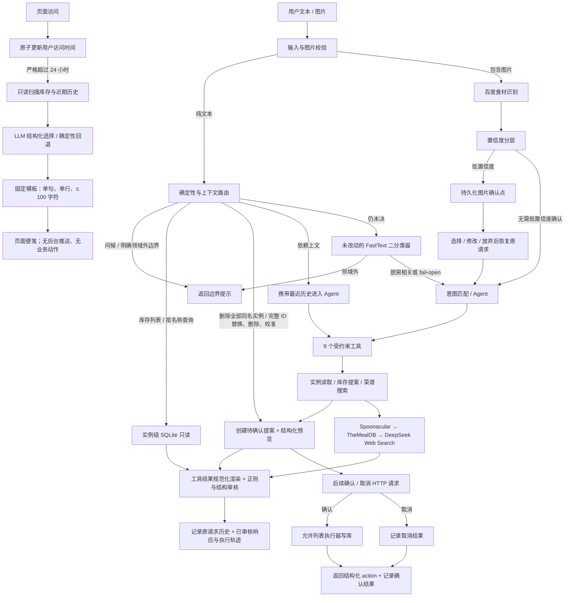

# Kitchen Inventory Agent

Kitchen Inventory Agent 解决的不是“把食材名称存进数据库”这么简单的问题，而是家庭库存里更真实、也更容易被 Agent 误处理的状态：同名食材可能来自不同批次，“半袋”“约 400g–500g”不能安全换算，删除与修改不能在模型猜测后立即生效，临期提醒也不应偷偷替用户执行操作。

当前版本已经形成一条可运行、可确认、可审查的请求链路：库存以独立实例保存原始数量文本；新增、整项替换、单实例删除、同名批量删除和“我刚确认过”校准全部先生成持久化提案；确定性与上下文路由先于未改动的 FastText 二分类器；用户再次访问页面且距上次访问严格超过 24 小时时，系统最多展示一句 100 个 Unicode 字符以内的只读库存建议。

安全边界同样明确：语言模型不能直接写 SQLite，主动建议不会创建提案、删除食材、补充库存或发送后台通知。模型负责理解、选择受约束的工具和辅助判断保质期；代码负责完整实例身份、原文保持、确认预览、确认门、优先级、固定提醒模板，以及从结构化工具结果生成可审计回答。

## 核心能力

| 能力 | 当前实现 |
| --- | --- |
| 真实库存语义 | 每次购入保存为带 `instance_id` 的库存实例；同名实例彼此独立，不合并、不做数据库数量运算 |
| 原始数量表达 | `quantity_text` 是不透明的单行文本，从仓库、API、工具、Agent 上下文到审核均保持原文 |
| 保质期与校准 | 新增时优先采用用户给出的日期，否则使用 LLM 结构化推断；失败、过去时间或无时区结果安全回退为 `unknown`；记录 `last_confirmed_at` |
| 人工确认 | 五类写操作都只创建持久化提案；提案保存并由 API／页面展示新增值、当前与拟替换值、完整目标 ID 或批量目标与预计数量，确认后才写库 |
| 主动库存建议 | 页面访问触发检查；距该用户上次访问严格超过 24 小时才扫描过期、3 天内临期、超过 14 天未确认和可能缺货线索，只展示一句固定安全文案 |
| 请求路由 | 问候、明确库存指令和依赖上文的追问先走确定性／上下文规则；仍未决的文本才交给原有 FastText 二分类器 |
| 图片识别 | 接入百度果蔬识别 API，校验图片格式、尺寸和长宽比，并按置信度分层处理结果 |
| 菜谱检索 | Spoonacular 主检索、TheMealDB 回退、DeepSeek 官方 Web Search 最终兜底，统一结果并执行过敏原过滤 |
| 对话记忆 | 请求、最终回答、工具记录和确认结果写入 SQLite，每个用户保留最近 5 段非递归历史 |
| 输出审核与轨迹 | 只要 Agent 读取库存或创建提案，就从工具快照生成固定结构回答；核对完整 ID、数量原文、待确认预览、菜谱来源和图片确认记录 |

## 系统架构



这条架构刻意把“模型建议”和“状态变化”分开。Agent 只能调用预先定义的工具，库存写工具只生成带 `preview` 的 `pending` 提案；主动检查甚至不会生成提案，只返回可选的页面文案。库存读取或提案一旦出现在 Agent 工具历史中，模型撰写的库存段落会被丢弃，改由程序从结构化结果生成固定回答；后续 `/api/actions/{action_id}/confirm` 与 `/api/actions/{action_id}/cancel` 直接返回序列化 action，并把确认或取消结果写入历史。

## 已实现功能

### 1. 实例级 SQLite 库存

库存表当前保存以下字段：

```text
instance_id / name / quantity_text / stocked_at / expires_at /
expiry_source / last_confirmed_at
```

这里有三项关键语义：

- **同名不等于同一项**：两次购入“牛奶”会获得两个不同的 `instance_id`，按名称查询返回全部匹配实例。直接回答、Agent 规范化回答、提案摘要、确认预览和库存卡片都展示完整 ID；短前缀不被任何修改入口接受为权限。
- **`quantity_text` 不透明**：系统只校验非空、单行和长度边界，不解析、不换算、不累加，也不会把“半袋”“大约 100 个”改写成数值。相对用量只有在 Agent 能可靠形成新的完整文本并确定唯一实例后，才可生成整项替换提案；否则要求用户澄清。
- **替换而非算术更新**：`inventory.replace` 一次提交目标实例的新 `quantity_text`、`expires_at` 和 `expiry_source`。数据库没有部分扣减或单位合并逻辑。

列表使用 `ORDER BY name, stocked_at, instance_id`，并分别为 `name`、`expires_at`、`last_confirmed_at` 建立索引。所有日期写入前转换为 UTC ISO 8601；库存 API 只返回上面的七字段 v2 合约。

#### 一次性的破坏性旧数据迁移

这一版本没有尝试猜测旧聚合库存中的批次、原始表达或日期。初始化通过 `PRAGMA table_xinfo` 比较有序的列名、规范化声明类型、`NOT NULL`、默认值、主键位置和隐藏列状态，并同时核对规范化的 `sqlite_master` 建表 SQL。只有原实现的完整旧签名——`name TEXT PRIMARY KEY, quantity REAL NOT NULL CHECK (quantity >= 0), unit TEXT NOT NULL`，且不存在 `schema_versions` 表——才会在同一 `BEGIN IMMEDIATE` 事务中删除旧表并建立 v2；该已知旧格式的数据会永久清空，部署前应自行备份。

精确 v2 只有在库存表定义、`schema_versions(version INTEGER PRIMARY KEY)` 定义和唯一版本标记 `2` 三者一致时才有效并原样保留。旧表旁出现 v2 标记、v2 缺少标记、类型／约束／默认值／主键不同、额外表约束、额外或缺失列、重排列、局部状态、未知版本表或未来版本号都会抛出清晰的 `InventorySchemaError` 并回滚初始化，不删除原表或数据。全新空数据库仍会正常建立完整 v2；新增使用显式 `INSERT` 列表，避免列顺序变化导致错位写入。

### 2. 保质期推断与最后确认时间

新增实例的过期信息遵循保守顺序：

1. 用户明确提供带时区的 `expires_at` 时直接采用，并标记 `expiry_source=user`；
2. 未提供时，DeepSeek 通过结构化输出仅返回可选日期；
3. 只有带时区且晚于当前时间的结果才标记为 `llm`；
4. 模型未配置、调用失败、返回空值、过去时间或无时区时间时，保存 `expires_at=null`、`expiry_source=unknown`，提案流程继续进行；直接与 Agent 新增路径同时记录 `expiry_inference: degraded` 的安全轨迹，只说明日期未知，不保存供应商响应或异常详情。

`last_confirmed_at` 在实例创建时初始化。“这个库存还在”的校准使用独立 `inventory.confirm` 提案，用户确认执行后才刷新时间；普通替换不会把库存误记为刚刚人工核对。这个字段也用于识别严格超过 14 天未确认的实例。

### 3. 两阶段库存写入

当前允许列表包含：

```text
inventory.add
inventory.replace
inventory.remove
inventory.remove_all
inventory.confirm
```

所有操作，包括按名称删除全部实例和刷新最后确认时间，都采用同一流程：

1. Pydantic 拒绝额外字段、无效来源、无时区日期和越界文本；
2. 提案以 `pending` 状态持久化，并设置默认 15 分钟有效期；`preview_json` 通过安全的加列迁移兼容已有提案表；迁移时，缺失、空、损坏或与参数不一致的旧库存预览会被标为 `failed` 并要求重新创建，已执行历史保持不变；
3. 确认时先在服务端重新校验持久化预览，再使用 `BEGIN IMMEDIATE` 原子领取执行权并把状态变为 `executing`；
4. 允许列表执行器针对具体实例或精确名称写库；
5. 结构化快照写入提案结果，状态变为 `executed`；
6. 对已执行提案重复确认会返回原结果，不重复新增、删除或校准。

`preview` 来自提案创建当时的真实仓库状态：新增展示食材、数量、日期和来源；替换并列当前与拟替换值；删除和校准展示完整当前实例；同名全部删除展示精确名称、每条完整实例和预计数量。未知实例以及无匹配的批量删除在提案持久化前失败。`GET /api/actions` 原样返回这些结构，页面为五类操作提供明确标签和可复制的完整 ID；收到空预览时页面隐藏并禁用确认按钮，服务端仍会独立拒绝确认，不能依赖前端作为唯一防线。

提案还支持 `cancelled`、`expired` 和 `failed`，并检查所属 `user_id`。提案状态与实际库存写入目前仍是两个 SQLite 事务；进程恰好在二者之间崩溃时，没有完整的自动恢复协议，这是当前明确保留的边界。

### 4. 确定性／上下文路由先行，FastText 保持不变

纯文本不会一律先送入分类器。当前顺序是：

1. `route_deterministically` 先识别单独问候、库存列表、按精确名称查询、格式明确的新增、按名称删除全部实例、锚定的完整 ID 替换／删除／校准，以及“下一步呢”“用了一半”“删掉它”等上下文依赖表达；
2. 单独问候直接返回领域边界；明确读取和上述五类写入直接走真实仓库或提案服务；完整 ID 替换保留不透明的新数量文本并沿用目标实例的日期信息；上下文依赖表达携带最近历史进入 Agent；这些路径均跳过 FastText；
3. 其余未决文本才调用现有二分类器，包括编程、天气、订单、购物车和支付类请求；分类器判为领域外时停止，判为相关或发生 fail-open 时继续到意图／Agent；
4. 图片请求跳过纯文本分类，进入图片处理链路。

执行轨迹对此采用两种表达：确定性和上下文文本路径记录 `deterministic_route`，但不追加 `food_query_classifier` 事件，因此是否绕过分类器需要从前者推断；只有图片请求会显式记录 `food_query_classifier: skipped`。未决文本实际调用分类器时才会出现其成功、`unavailable` 或 `fail-open` 相关事件。

FastText 的模型、数据、训练与推理文件没有因这套路由调整而修改。应用启动时仍只加载一次模型；模型文件缺失、版本不兼容或预测异常时，请求继续处理，并在执行轨迹中记录 `unavailable` 或 `fail-open`。

分类器本身仍执行 NFKC 规范化、英文小写和 jieba 分词，使用 FastText supervised 模型与 softmax 损失；训练／验证／测试划分、阈值选择和离线指标保持原样。

### 5. 图片识别、置信度分层与人工确认

图片进入百度果蔬识别 API 前执行确定性校验：

- 最大文件大小 3 MiB；
- 仅接受 JPEG、PNG 和 BMP；
- 图片边长 15–4096 px；
- 长宽比不超过 3:1；
- Pillow 必须能够解码图片内容。

识别结果按置信度处理：

| 置信度 | 状态 | 处理方式 |
| --- | --- | --- |
| `>= 0.85` | `accepted` | 直接进入当前请求上下文 |
| `>= 0.50` 且 `< 0.85` | `needs_confirmation` | 可以进入上下文，但程序确定性追加核对提醒 |
| `< 0.50` | `rejected` | 暂不进入 Agent，先创建持久化人工确认点 |

低置信度确认点保存原请求、目标语言、全部识别结果、有效期和状态。用户可以选择、修改或放弃候选；确认后的 `user_confirmed` 项必须能在确认记录中找到，系统随后恢复原请求。已完成确认保存最终结果，重复读取时返回已保存结果。

### 6. LangChain Agent 与实例工具边界

复杂请求由基于 `ChatOpenAI` 兼容接口的 DeepSeek 模型处理，并通过 LangChain `create_agent` 组织以下 9 个工具：

```text
list_inventory_instances
find_inventory_instances
get_inventory_instance
propose_add_inventory_instance
propose_replace_inventory_instance
propose_remove_inventory_instance
propose_remove_all_inventory_instances
propose_confirm_inventory_instance
search_recipes
```

实例写工具还有一层调用期约束：替换、删除和校准前必须读取真实实例。同名查询只有一个结果时可以确定目标；存在多个同名实例时会标记歧义，必须由用户提供完整实例 ID 后才能提出单实例变更。即使两个 UUID 共享旧版显示前缀，短前缀也不会解除歧义。按名称删除全部实例也要求先查到该名称。

Agent 负责理解请求、形成完整的新数量文本、生成英文菜谱 API 参数并组织回答；代码负责工具允许列表、实例查找状态、确认执行、过敏原完整性、图片状态和最终审核。Agent 设置了最大输入字符数、最大输出 Token、HTTP 超时、有限重试和递归上限。

当前 Agent 仍由工具调用过程隐式编排，没有独立的结构化 Plan、任务依赖图或前端步骤状态模型。

### 7. Spoonacular、TheMealDB 与 DeepSeek Web Search 菜谱路由

菜谱工具至少要求一个英文食材参数。配置 Spoonacular 密钥时先调用 `/recipes/complexSearch`，映射食材、饮食、菜系、餐型、最大制作时间、排序和过敏原；结果统一为标题、步骤、原料、来源链接和图片链接，并执行去重与过敏原字符串过滤。Spoonacular 失败或没有安全结果时，系统使用 TheMealDB 搜索第一个食材并读取详情。两者均无安全结果且已配置 `DEEPSEEK_API_KEY` 时，系统通过 DeepSeek 官方 Anthropic 兼容端点调用服务端 Web Search；网页召回结果必须带有效 HTTP(S) 来源链接，并再次执行相同的去重和过敏原过滤。

Spoonacular 当前支持 `max-used-ingredients` 和 `min-missing-ingredients` 两种 API 排序方式。DeepSeek Web Search 每次兜底最多发起一次搜索，并会产生额外模型与搜索费用。系统没有本地菜谱数据集、向量召回或多因素融合排序，候选质量仍主要依赖外部 API。

### 8. 结构化过敏原约束

用户画像把过敏原分成 Spoonacular 官方支持的 12 类 intolerance，以及腰果、虾皮等自定义具体食材。调用菜谱工具时，确定性代码要求完整传入所有官方类别；每个自定义食材必须同时提供原文和英文 API 映射，不能遗漏或夹带未配置项目。英文名称合并到 `excludeIngredients`，返回后再次扫描标题、步骤和原料。

这把“不要漏掉过敏原”从 Prompt 要求提升成工具参数校验。自定义映射仍由模型生成，当前没有独立的食材别名、衍生物和未知成分知识库。

### 9. 访问触发的主动库存建议

前端加载时调用 `POST /api/proactive-check`。后端在 SQLite 中按用户保存 `last_visited_at`，并用 `BEGIN IMMEDIATE` 完成“读取旧时间 + 写入本次时间”：

- 首次访问只建立基线，不展示建议；
- 与上次访问正好相隔 24 小时仍不展示；
- 严格超过 24 小时才扫描；
- 每次调用都会刷新访问时间，因此立即刷新页面不会重复展示，并发调用也最多一个拿到本轮检查资格。

候选优先级固定为：已过期、未来 3 天内临期、严格超过 14 天未确认、可能需要补充。LLM 只能结构化选择 `category` 和真实库存中的 `item_name`，必须服从前三类的最高优先级；应用不会显示模型自由文本，而是按类别渲染固定模板。模型异常、无效选择或服务失败不会阻塞库存接口或页面访问：有确定性候选时回退到对应安全模板，没有候选时返回 `null`。

最终建议必须是固定允许集合中的一句话、单行、带句末标点且不超过 100 个 Unicode 字符。文案不会插入不受信任的食材名、Markdown、操作 ID 或执行声明。

这不是常驻调度器：没有定时后台任务、浏览器推送、邮件或移动通知，也不会因建议而修改库存、生成待确认操作、改写对话历史、丢弃过期食材或代为采购。

### 10. 五段对话记忆

长期用户画像保存在 Markdown 中；对话历史使用 SQLite 保存当前轮请求、最终回答、工具记录和确认结果。每个用户最多保留最近 5 段，构建上下文时不会把旧历史再次写入新记录，旧版 Markdown 的静态历史摘要也会剔除。

库存确认结果和完成后的图片确认结果会进入历史。领域分类直接拦截和等待图片确认的中间响应还没有统一为完整历史段。主动检查只读取近期历史，不追加或修改历史。

### 11. 规范化库存回答与实例级工具审核

审核不再尝试用单一正则从任意模型文案中“猜”库存事实。只要 Agent 工具历史包含任一库存读取或提案，程序会丢弃模型撰写的库存／待确认段落，并从结构化结果生成固定 Markdown：

- `list`、`find`、`get` 逐实例展示完整 `instance_id`、原始 `quantity_text`、`stocked_at`、过期时间、来源和最后确认时间；
- 五类 `propose_*` 固定展示 `status=pending（尚未执行）`、完整 action ID 和持久化 `preview`，不会保留模型声称“已经添加／删除”的文案；
- 混合库存与菜谱请求会追加 `search_recipes` 结果中的原始标题、完整原料、步骤、来源和经工具审核的 HTTP(S) 来源链接；空结果会明确说明没有匹配菜谱，不会静默消失；
- 规范化渲染接收 `target_language`：中文使用中文标题和 pending 提示，英语及其他非中文值使用安全的英文回退；模型库存文案仍不会重新进入结果；
- 页面在 HTML 转义后只把 HTTP(S) Markdown 来源转换为带 `noopener noreferrer` 的真实链接，其他协议保持为不可执行文本；
- 审核重新计算同一规范输出并要求精确匹配，因此自然语言散文、Markdown 表格、引用块、省略 ID、短 ID 或英文执行声明都不能绕过；
- 工具参数、结果字段、UTC 时间、完整 ID、提案 operation、参数与预览仍逐项校验；图片置信度与用户确认记录沿用原有约束。

没有库存工具历史时，普通回答仍经过空输出、提示注入式语句和不支持付款／下单声明的正则检查，以及菜谱来源和图片记录审核。库存提案之后的确认／取消接口返回结构化 action，不生成新的自然语言 Agent 回答；它们仍受用户归属、状态转换、允许列表和历史记录约束。独立二次审核模型仍未实现。

### 12. 可视化执行轨迹

`/api/process` 请求以 `stage / name / status / detail / duration_ms` 记录实际执行阶段。轨迹显示 `deterministic_route` 是否命中，以及未决文本的 FastText 调用、`unavailable` 或 `fail-open`；确定性／上下文文本路径没有单独的 classifier-skipped 事件，其绕过行为由 `deterministic_route` 推断，图片请求才显式记录分类器 `skipped`。进入相应链路后，轨迹还包含实例读取、提案创建、外部 API、DeepSeek Agent、正则审核和工具调用审核；新增日期无法推断时额外记录安全的 `expiry_inference / degraded / unknown expiry` 事件。

异常轨迹只保存异常类型和安全摘要，避免把密钥或原始服务响应返回浏览器。轨迹仍随单次响应返回，没有跨请求统计存储，也没有 Token、费用或首字延迟指标。

## 关键设计取舍

### 模型负责理解，代码负责约束

模型适合处理“用了一半”这样的上下文、英文 API 词项和候选选择；它不适合猜测哪个同名批次应该被删除，也不应把“半袋”强制转换成小数。实例身份、数量原文、确认状态和提醒模板因此留在确定性代码中。

### 可恢复的确认点

库存提案和图片确认都持久化到 SQLite。服务重启后仍可按 ID 找到记录；库存确认通过原子状态领取避免重复执行。图片确认保存最终结果，但恢复原请求前还没有同等级别的原子领取，并发恢复保护仍可增强。

### 外部服务安全降级

分类器不可用时 fail-open；保质期推断失败时保存 `unknown` 并留下无供应商详情的降级轨迹；Spoonacular 失败时回退 TheMealDB，两者无安全结果时再回退 DeepSeek Web Search；主动建议选择失败时使用固定模板或返回空。降级不会绕过库存确认，也不会把外部异常变成隐式写操作。

## 验证与指标

### 自动化测试

当前完整测试套件为 **228 项通过测试**。最初修复前基线为 165 项，更新后的全量验证使用：

```bash
TMPDIR=/tmp TMP=/tmp TEMP=/tmp .venv/bin/python -m pytest -q
```

pytest 自动化覆盖重点包括：

- 同名实例独立、`quantity_text` 原文保持、完整旧签名破坏性迁移、v2 重启存活，以及类型、空值约束、默认值、主键、附加表约束、版本矛盾、缺失标记、额外／重排／未来 schema 拒绝且数据保留；
- `stocked_at` 七字段 API、三项索引、稳定排序和显式插入列；
- 新增保质期的用户值优先、LLM 结构化推断、`unknown` 回退与直接／Agent 安全降级轨迹；
- 五类库存操作的参数、完整 ID、持久化预览和目标语义，包括无匹配提案前拒绝、旧空／损坏预览迁移失败、确认期二次预览校验、已执行历史保留、重复确认幂等、整项替换、单实例删除、精确名称批量删除和校准执行；
- 确定性／上下文路由绕过分类器，完整 ID 替换／删除／校准直接创建 pending，未决领域请求进入未改动的 FastText；
- 共享短前缀歧义、Agent 完整 ID 授权、相对用量整项替换，以及规范化审核拒绝散文、表格、引用、省略 ID、篡改数量和中英文执行声明；
- 严格 24 小时访问边界、并发抑制、候选优先级、100 字符单句模板和只读副作用检查；
- 图片格式与置信度、过敏原参数、菜谱主备路由、混合结果的中英文原料／步骤／来源与空结果、用户画像初始化与过敏原读写、近期历史传入上下文及主动检查的只读性、HTTP 输入限制、前端静态壳与实例 API 响应、Node 执行的安全 Markdown 链接渲染，以及 Linux 脚本契约。

当前 pytest 没有直接覆盖提案到期、取消、跨用户确认／取消或对话历史保留最近 5 段时的裁剪／顺序边界；它会在 Node 中执行独立 Markdown 渲染器并验证 action JSON 和前端静态契约，但仍不会执行整个 `frontend/app.js` 观察真实 DOM。

本轮另用隔离数据库启动 Uvicorn，并以真实 headless Chromium 执行页面脚本。渲染后的 DOM 同时出现 `inventory.add`、`replace`、`remove`、`remove_all`、`confirm` 五类有效预览，包含两个同名实例、两个完整可见 ID、拟新增／拟替换数量、日期来源、上次确认时间和预计删除数量。追加的异常场景通过 API 注入一个空预览：对应卡片呈现 `data-preview-ready=false`，确认按钮同时带 `disabled`、`hidden` 和 `aria-disabled=true`；自动提交的混合结果把审核过的 `https://recipes.example/tomato-soup` 渲染为带 `_blank` 和 `noopener noreferrer` 的真实锚点，并保留英文原料和步骤。页面加载日志只有一次 `POST /api/proactive-check`，`markdown.js`、`app.js` 和自动提交均返回 200，Chromium 输出没有 JavaScript `SyntaxError`、`ReferenceError`、`TypeError` 或 `Uncaught`。这是真实运行烟雾证据，但完整 `frontend/app.js` 场景尚未纳入可重复的 CI 浏览器测试，仍是已知覆盖缺口。

### 分类器数据与效果

数据集包含 300 条查询；部署模型使用训练集和验证集共 254 条样本重新训练，独立测试集不参与训练或阈值选择。

| 数据集 | 样本数 | 准确率 | 精确率 | 召回率 | 假阳性率 |
| --- | ---: | ---: | ---: | ---: | ---: |
| 验证集 | 44 | 88.64% | 81.48% | 100.00% | 22.73% |
| 独立测试集 | 46 | 80.43% | 75.00% | 91.30% | 30.43% |

| 用途 | 样本数 |
| --- | ---: |
| 初始训练集 | 210 |
| 验证集 | 44 |
| 独立测试集 | 46 |
| 部署模型训练集 | 254 |

分类器提供保守的领域门禁，但当前数据规模较小，独立测试集准确率约 80.43%、假阳性率约 30.43%。后续仍应补充困难负样本、边界正样本和显式不确定路径；新的确定性先行路由并不改变这些离线指标。

## 当前能力边界与提升空间

| 方向 | 已有基础 | 当前边界 |
| --- | --- | --- |
| 库存语义 | 实例 ID、同名多实例、原始数量文本、日期来源和最后确认时间 | 没有数量解析、单位换算、合并、部分扣减或数据库库存算术 |
| 数据迁移 | 按完整有序属性、建表约束和版本状态只破坏性识别已知旧签名；未知／未来／矛盾状态 fail closed | 已知旧聚合库存仍被清空，没有自动转换或恢复工具；旧的非标准 schema 需要人工迁移 |
| 写入安全 | 五类持久化提案、真实状态预览、旧无效预览失效、确认期复验、完整 ID、用户隔离、原子领取和重复确认幂等 | 提案状态与库存写入之间缺少跨事务崩溃恢复和追加式事件日志 |
| 主动建议 | 访问节流、候选优先级、受约束模型选择、固定安全模板 | 只在页面访问时检查；没有后台调度、外部通知或任何代执行能力 |
| 路由 | 确定性／上下文优先，未决请求使用 FastText，分类失败时 fail-open | 规则语言覆盖有限，二分类数据规模与边界精度仍需提升 |
| 图片确认 | 持久化候选、编辑／放弃、原请求恢复和结果保存 | 恢复执行尚缺原子领取与更完整的并发保护 |
| 菜谱检索 | 两个外部源、过敏原工具校验、结果过滤，以及规范化中英文详情／空结果和安全来源链接 | 没有本地检索、向量召回、营养求解或多日菜单规划 |
| 对话与审计 | 五段历史、实例工具记录和关键事实一致性审核 | 早期返回未完全统一持久化，审核不覆盖任意自然语言事实 |

此外，当前仍没有独立结构化 Plan、审核 Agent、食材／营养标准化 API、通用网页搜索、根据菜谱份数生成成组扣减提案、经确认写回饮食偏好候选或账户登录与多租户鉴权。

## 项目结构

```text
app/
├── actions.py                # 实例变更提案、确认状态与允许列表执行
├── adapters/
│   ├── recipe_api.py         # Spoonacular / TheMealDB / DeepSeek Web Search 适配器
│   └── vision_api.py         # 百度果蔬识别适配器
├── agent.py                  # LangChain Agent 与 9 个工具
├── audit.py                  # 正则与实例级工具调用审核
├── config.py                 # 环境变量配置
├── context.py                # Agent 上下文和响应模型
├── expiry.py                 # 结构化保质期推断
├── intent.py                 # 确定性／上下文路由与意图匹配
├── memory.py                 # 用户画像和五段对话历史
├── pipeline.py               # 顶层请求编排
├── proactive.py              # 访问节流、候选选择与固定提醒模板
├── prompts.py                # Agent 实例语义约束
├── tools/
│   ├── inventory.py          # SQLite 实例库存仓库
│   └── recipe.py             # 菜谱主备路由与过滤
├── templates/user_profile.md # 基础用户画像模板
├── trace.py                  # 请求级执行轨迹
├── vision.py                 # 图片校验和置信度分层
├── vision_confirmations.py   # 图片确认持久化
└── web.py                    # FastAPI 接口

classifier/                   # 未改动的 FastText 数据、训练、评估与运行时
frontend/                     # 页面、实例库存、主动便笺和执行轨迹
scripts/                      # Linux Bash 启停脚本
tests/                        # 228 项 pytest 测试
main.py                       # CLI 入口
```

## 环境要求与安装

项目使用 `enum.StrEnum`，需要 **Python 3.11 或更高版本**。

```bash
python3.13 -m venv .venv
.venv/bin/python -m pip install -r requirements.txt
cp .env.example .env
```

## 配置

### Agent 与外部服务

| 变量 | 默认值 | 说明 |
| --- | --- | --- |
| `DEEPSEEK_API_KEY` | 空 | Agent、保质期推断、主动候选选择与最终菜谱 Web Search 兜底所需 |
| `DEEPSEEK_MODEL` | `deepseek-v4-flash` | OpenAI 兼容模型名称 |
| `DEEPSEEK_BASE_URL` | `https://api.deepseek.com` | 模型 API 地址 |
| `DEEPSEEK_MAX_OUTPUT_TOKENS` | `800` | 单次模型最大输出 Token |
| `DEEPSEEK_MAX_INPUT_CHARS` | `12000` | Agent 与主动选择负载的字符上限 |
| `AGENT_RECURSION_LIMIT` | `10` | LangChain Agent 递归上限 |
| `BAIDU_IMAGE_API_KEY` | 空 | 图片食材识别所需 |
| `BAIDU_IMAGE_SECRET_KEY` | 空 | 图片食材识别所需 |
| `BAIDU_IMAGE_ENDPOINT` | 百度果蔬识别接口 | 图片识别地址 |
| `SPOONACULAR_API_KEY` | 空 | 可选主菜谱源；未配置时使用 TheMealDB |
| `SPOONACULAR_BASE_URL` | `https://api.spoonacular.com` | Spoonacular API 地址 |
| `THEMEALDB_API_KEY` | `1` | TheMealDB API 路径密钥 |
| `THEMEALDB_BASE_URL` | `https://www.themealdb.com/api/json/v1` | TheMealDB API 地址 |
| `HTTP_TIMEOUT_SECONDS` | `20` | 外部 HTTP 与模型请求超时 |

### 本地状态与分类器

| 变量 | 默认值 | 说明 |
| --- | --- | --- |
| `INVENTORY_DB_PATH` | `data/inventory.db` | 实例库存、提案、访问时间、历史和图片确认 SQLite 文件 |
| `USER_PROFILE_PATH` | `data/user_profile.md` | Markdown 用户画像路径 |
| `PENDING_ACTION_TTL_MINUTES` | `15` | 库存提案和图片确认有效期 |
| `FOOD_CLASSIFIER_ENABLED` | `true` | 是否启用领域分类器 |
| `FOOD_CLASSIFIER_MODEL_PATH` | `classifier/artifacts/food_query.bin` | FastText 模型路径 |
| `FOOD_CLASSIFIER_METADATA_PATH` | `classifier/artifacts/metadata.json` | 分类阈值和预处理元数据 |

当用户画像不存在时，应用从受版本控制的 `app/templates/user_profile.md` 创建基础文件，已有画像不会被覆盖。

## 运行方式

### Web 展示页

```bash
./scripts/start.sh
```

访问 `http://127.0.0.1:8000`。页面包含文本／图片输入、低置信度确认、实例库存、待确认操作、过敏原设置、主动库存便笺和执行轨迹。停止或指定端口：

```bash
./scripts/stop.sh
./scripts/start.sh --port 8080
./scripts/stop.sh --port 8080
```

### CLI

```bash
.venv/bin/python main.py \
  --text "查询一下当前库存" \
  --user-id "demo-user" \
  --language zh
```

图片请求：

```bash
.venv/bin/python main.py \
  --text "根据图片里的食材推荐菜谱" \
  --image "./sample.jpg" \
  --user-id "demo-user" \
  --language zh
```

CLI 输出完整 JSON。继续图片确认或库存提案时，可使用对应 HTTP 接口或展示页。

## HTTP API

FastAPI OpenAPI 文档位于 `http://127.0.0.1:8000/docs`。

| 方法 | 路径 | 用途 |
| --- | --- | --- |
| `GET` | `/api/status` | 查看服务配置状态和输入限制 |
| `POST` | `/api/process` | 处理文本或图片请求 |
| `GET` | `/api/inventory` | 获取全部库存实例快照 |
| `POST` | `/api/proactive-check` | 记录页面访问，并在符合节流条件时返回只读建议或 `null` |
| `GET` | `/api/allergens` | 获取过敏原选项和当前设置 |
| `PUT` | `/api/allergens` | 更新官方和自定义过敏原 |
| `GET` | `/api/actions` | 获取待确认库存提案及其结构化 `preview` |
| `POST` | `/api/actions/{action_id}/confirm` | 确认并执行库存提案 |
| `POST` | `/api/actions/{action_id}/cancel` | 取消库存提案 |
| `POST` | `/api/vision-confirmations/{confirmation_id}/resolve` | 提交图片候选选择并恢复原请求 |

当前展示接口使用固定 showcase 用户，没有账户注册、登录和多租户鉴权。底层提案、历史、访问时间和图片确认仍按 `user_id` 保存或检查。

## 分类器训练与评估

训练脚本使用 FastText 0.9.2 CLI；应用内推理使用与 `.bin` 文件兼容的 `fasttext-predict`。

```bash
./classifier/build_fasttext.sh
.venv/bin/python -m classifier.train
.venv/bin/python -m classifier.evaluate \
  --dataset classifier/dataset/semantic_food_query_dataset_300.csv
```
