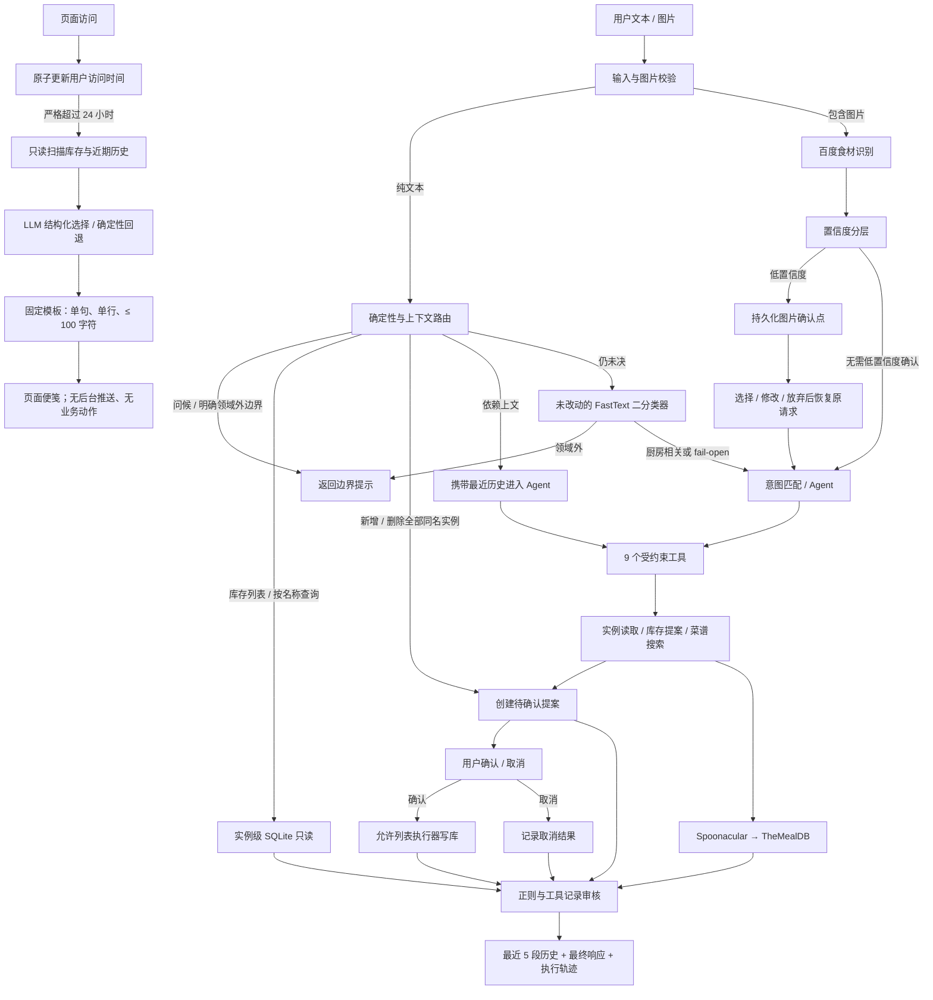

# Kitchen Inventory Agent

Kitchen Inventory Agent 解决的不是“把食材名称存进数据库”这么简单的问题，而是家庭库存里更真实、也更容易被 Agent 误处理的状态：同名食材可能来自不同批次，“半袋”“约 400g–500g”不能安全换算，删除与修改不能在模型猜测后立即生效，临期提醒也不应偷偷替用户执行操作。

当前版本已经形成一条可运行、可确认、可审查的请求链路：库存以独立实例保存原始数量文本；新增、整项替换、单实例删除、同名批量删除和“我刚确认过”校准全部先生成持久化提案；确定性与上下文路由先于未改动的 FastText 二分类器；用户再次访问页面且距上次访问严格超过 24 小时时，系统最多展示一句 100 个 Unicode 字符以内的只读库存建议。

安全边界同样明确：语言模型不能直接写 SQLite，主动建议不会创建提案、删除食材、补充库存或发送后台通知。模型负责理解、选择受约束的工具和辅助判断保质期；代码负责实例身份、原文保持、确认门、优先级、固定提醒模板和输出审查。

## 核心能力

| 能力 | 当前实现 |
| --- | --- |
| 真实库存语义 | 每次购入保存为带 `instance_id` 的库存实例；同名实例彼此独立，不合并、不做数据库数量运算 |
| 原始数量表达 | `quantity_text` 是不透明的单行文本，从仓库、API、工具、Agent 上下文到审核均保持原文 |
| 保质期与校准 | 新增时优先采用用户给出的日期，否则使用 LLM 结构化推断；失败、过去时间或无时区结果安全回退为 `unknown`；记录 `last_confirmed_at` |
| 人工确认 | 新增、完整替换、单实例删除、同名全部删除和库存校准都只创建持久化提案，确认后才由允许列表执行器写库 |
| 主动库存建议 | 页面访问触发检查；距该用户上次访问严格超过 24 小时才扫描过期、3 天内临期、超过 14 天未确认和可能缺货线索，只展示一句固定安全文案 |
| 请求路由 | 问候、明确库存指令和依赖上文的追问先走确定性／上下文规则；仍未决的文本才交给原有 FastText 二分类器 |
| 图片识别 | 接入百度果蔬识别 API，校验图片格式、尺寸和长宽比，并按置信度分层处理结果 |
| 菜谱检索 | Spoonacular 作为主检索源、TheMealDB 作为回退源，统一结果并执行过敏原过滤 |
| 对话记忆 | 请求、最终回答、工具记录和确认结果写入 SQLite，每个用户保留最近 5 段非递归历史 |
| 输出审核与轨迹 | 核对实例 ID、数量原文、待确认状态、菜谱来源和图片确认记录；展示路由、工具、外部服务、数据库与审核阶段 |

## 系统架构



这条架构刻意把“模型建议”和“状态变化”分开。Agent 只能调用预先定义的工具，库存写工具只生成 `pending` 提案；主动检查甚至不会生成提案，只返回可选的页面文案。

## 已实现功能

### 1. 实例级 SQLite 库存

库存表当前保存以下字段：

```text
instance_id / name / quantity_text / expires_at / expiry_source /
created_at / updated_at / last_confirmed_at
```

这里有三项关键语义：

- **同名不等于同一项**：两次购入“牛奶”会获得两个不同的 `instance_id`，按名称查询返回全部匹配实例。读取结果和界面均展示短实例 ID，修改或删除单项时使用完整 ID。
- **`quantity_text` 不透明**：系统只校验非空、单行和长度边界，不解析、不换算、不累加，也不会把“半袋”“大约 100 个”改写成数值。相对用量只有在 Agent 能可靠形成新的完整文本并确定唯一实例后，才可生成整项替换提案；否则要求用户澄清。
- **替换而非算术更新**：`inventory.replace` 一次提交目标实例的新 `quantity_text`、`expires_at` 和 `expiry_source`。数据库没有部分扣减或单位合并逻辑。

#### 一次性的破坏性旧数据迁移

这一版本没有尝试猜测旧聚合库存中的批次、原始表达或日期。如果启动时检测到现有 `inventory` 表的列集合不是新实例架构，初始化会在同一 `BEGIN IMMEDIATE` 事务中删除整张旧表并重建，因此旧库存记录会被永久清空，无法由应用自动恢复。这是有意的破坏性迁移，部署前应自行备份需要保留的数据库。

初始化后的新表不会在重启时重复删除：新实例行会正常存活。旧格式、仍处于 `pending` 且参数包含数值 `quantity` 或 `unit` 的库存提案也会被移除，避免确认过时语义的写操作。

### 2. 保质期推断与最后确认时间

新增实例的过期信息遵循保守顺序：

1. 用户明确提供带时区的 `expires_at` 时直接采用，并标记 `expiry_source=user`；
2. 未提供时，DeepSeek 通过结构化输出仅返回可选日期；
3. 只有带时区且晚于当前时间的结果才标记为 `llm`；
4. 模型未配置、调用失败、返回空值、过去时间或无时区时间时，保存 `expires_at=null`、`expiry_source=unknown`，提案流程继续进行。

`last_confirmed_at` 在实例创建时初始化。“这个库存还在”的校准使用独立 `inventory.confirm` 提案，用户确认执行后才刷新时间；普通替换不会把库存误记为刚刚人工核对。这个字段也用于识别严格超过 14 天未确认的实例。

### 3. 两阶段库存写入

当前允许列表包含：

```text
inventory.add
inventory.replace
inventory.remove
inventory.remove_all
inventory.confirm
```

所有操作，包括按名称删除全部实例和刷新最后确认时间，都采用同一流程：

1. Pydantic 拒绝额外字段、无效来源、无时区日期和越界文本；
2. 提案以 `pending` 状态持久化，并设置默认 15 分钟有效期；
3. 确认时使用 `BEGIN IMMEDIATE` 原子领取执行权，状态变为 `executing`；
4. 允许列表执行器针对具体实例或精确名称写库；
5. 结构化快照写入提案结果，状态变为 `executed`；
6. 对已执行提案重复确认会返回原结果，不重复新增、删除或校准。

提案还支持 `cancelled`、`expired` 和 `failed`，并检查所属 `user_id`。提案状态与实际库存写入目前仍是两个 SQLite 事务；进程恰好在二者之间崩溃时，没有完整的自动恢复协议，这是当前明确保留的边界。

### 4. 确定性／上下文路由先行，FastText 保持不变

纯文本不会一律先送入分类器。当前顺序是：

1. `route_deterministically` 先识别单独问候、库存列表、按精确名称查询、格式明确的新增、按名称删除全部实例，以及“下一步呢”“用了一半”“删掉它”等上下文依赖表达；
2. 单独问候直接返回领域边界；明确的读取和部分写入直接走真实仓库或提案服务；上下文依赖表达携带最近历史进入 Agent；这些路径均跳过 FastText；
3. 其余未决文本才调用现有二分类器，包括编程、天气、订单、购物车和支付类请求；分类器判为领域外时停止，判为相关或发生 fail-open 时继续到意图／Agent；
4. 图片请求跳过纯文本分类，进入图片处理链路。

FastText 的模型、数据、训练与推理文件没有因这套路由调整而修改。应用启动时仍只加载一次模型；模型文件缺失、版本不兼容或预测异常时，请求继续处理，并在执行轨迹中记录 `unavailable` 或 `fail-open`。

分类器本身仍执行 NFKC 规范化、英文小写和 jieba 分词，使用 FastText supervised 模型与 softmax 损失；训练／验证／测试划分、阈值选择和离线指标保持原样。

### 5. 图片识别、置信度分层与人工确认

图片进入百度果蔬识别 API 前执行确定性校验：

- 最大文件大小 3 MiB；
- 仅接受 JPEG、PNG 和 BMP；
- 图片边长 15–4096 px；
- 长宽比不超过 3:1；
- Pillow 必须能够解码图片内容。

识别结果按置信度处理：

| 置信度 | 状态 | 处理方式 |
| --- | --- | --- |
| `>= 0.85` | `accepted` | 直接进入当前请求上下文 |
| `>= 0.50` 且 `< 0.85` | `needs_confirmation` | 可以进入上下文，但程序确定性追加核对提醒 |
| `< 0.50` | `rejected` | 暂不进入 Agent，先创建持久化人工确认点 |

低置信度确认点保存原请求、目标语言、全部识别结果、有效期和状态。用户可以选择、修改或放弃候选；确认后的 `user_confirmed` 项必须能在确认记录中找到，系统随后恢复原请求。已完成确认保存最终结果，重复读取时返回已保存结果。

### 6. LangChain Agent 与实例工具边界

复杂请求由基于 `ChatOpenAI` 兼容接口的 DeepSeek 模型处理，并通过 LangChain `create_agent` 组织以下 9 个工具：

```text
list_inventory_instances
find_inventory_instances
get_inventory_instance
propose_add_inventory_instance
propose_replace_inventory_instance
propose_remove_inventory_instance
propose_remove_all_inventory_instances
propose_confirm_inventory_instance
search_recipes
```

实例写工具还有一层调用期约束：替换、删除和校准前必须读取真实实例。同名查询只有一个结果时可以确定目标；存在多个同名实例时会标记歧义，必须由用户提供具体实例 ID 后才能提出单实例变更。按名称删除全部实例也要求先查到该名称。

Agent 负责理解请求、形成完整的新数量文本、生成英文菜谱 API 参数并组织回答；代码负责工具允许列表、实例查找状态、确认执行、过敏原完整性、图片状态和最终审核。Agent 设置了最大输入字符数、最大输出 Token、HTTP 超时、有限重试和递归上限。

当前 Agent 仍由工具调用过程隐式编排，没有独立的结构化 Plan、任务依赖图或前端步骤状态模型。

### 7. Spoonacular 与 TheMealDB 菜谱路由

菜谱工具至少要求一个英文食材参数。配置 Spoonacular 密钥时先调用 `/recipes/complexSearch`，映射食材、饮食、菜系、餐型、最大制作时间、排序和过敏原；结果统一为标题、步骤、原料、来源链接和图片链接，并执行去重与过敏原字符串过滤。Spoonacular 失败或没有安全结果时，系统使用 TheMealDB 搜索第一个食材并读取详情，再执行相同过滤。

Spoonacular 当前支持 `max-used-ingredients` 和 `min-missing-ingredients` 两种 API 排序方式。系统没有本地菜谱数据集、向量召回或多因素融合排序，候选质量仍主要依赖外部 API。

### 8. 结构化过敏原约束

用户画像把过敏原分成 Spoonacular 官方支持的 12 类 intolerance，以及腰果、虾皮等自定义具体食材。调用菜谱工具时，确定性代码要求完整传入所有官方类别；每个自定义食材必须同时提供原文和英文 API 映射，不能遗漏或夹带未配置项目。英文名称合并到 `excludeIngredients`，返回后再次扫描标题、步骤和原料。

这把“不要漏掉过敏原”从 Prompt 要求提升成工具参数校验。自定义映射仍由模型生成，当前没有独立的食材别名、衍生物和未知成分知识库。

### 9. 访问触发的主动库存建议

前端加载时调用 `POST /api/proactive-check`。后端在 SQLite 中按用户保存 `last_visited_at`，并用 `BEGIN IMMEDIATE` 完成“读取旧时间 + 写入本次时间”：

- 首次访问只建立基线，不展示建议；
- 与上次访问正好相隔 24 小时仍不展示；
- 严格超过 24 小时才扫描；
- 每次调用都会刷新访问时间，因此立即刷新页面不会重复展示，并发调用也最多一个拿到本轮检查资格。

候选优先级固定为：已过期、未来 3 天内临期、严格超过 14 天未确认、可能需要补充。LLM 只能结构化选择 `category` 和真实库存中的 `item_name`，必须服从前三类的最高优先级；应用不会显示模型自由文本，而是按类别渲染固定模板。模型异常、无效选择或服务失败不会阻塞库存接口或页面访问：有确定性候选时回退到对应安全模板，没有候选时返回 `null`。

最终建议必须是固定允许集合中的一句话、单行、带句末标点且不超过 100 个 Unicode 字符。文案不会插入不受信任的食材名、Markdown、操作 ID 或执行声明。

这不是常驻调度器：没有定时后台任务、浏览器推送、邮件或移动通知，也不会因建议而修改库存、生成待确认操作、改写对话历史、丢弃过期食材或代为采购。

### 10. 五段对话记忆

长期用户画像保存在 Markdown 中；对话历史使用 SQLite 保存当前轮请求、最终回答、工具记录和确认结果。每个用户最多保留最近 5 段，构建上下文时不会把旧历史再次写入新记录，旧版 Markdown 的静态历史摘要也会剔除。

库存确认结果和完成后的图片确认结果会进入历史。领域分类直接拦截和等待图片确认的中间响应还没有统一为完整历史段。主动检查只读取近期历史，不追加或修改历史。

### 11. 确定性输出与实例级工具审核

最终回答先经过正则审核，阻止提示注入式的“忽略之前／以上指令”、不支持的付款／下单执行声明和空回答。随后审核工具记录：

- 三种只读库存工具的参数和结果必须符合实例结构，`instance_id` 必须有效且不能重复；
- 回答中展示的名称、实例 ID 和 `quantity_text` 必须与真实工具快照精确一致；
- `find` 结果必须匹配请求名称，`get` 结果必须匹配请求 ID；
- 所有 `propose_*` 结果必须为 `pending`，调用参数要与持久化提案一致，回答不能声称已经执行；
- 菜谱标题和链接必须来自 `search_recipes` 结果；
- 低置信度图片不能绕过确认，中置信度提醒不能被省略，用户确认项必须有对应记录。

审核失败时，系统拦截原回答并返回统一提示。当前审核集中于库存、菜谱来源和图片确认等关键事实，没有覆盖任意自然语言陈述；独立的二次审核模型接口仍未实现。

### 12. 可视化执行轨迹

每次请求以 `stage / name / status / detail / duration_ms` 记录实际执行阶段。轨迹现在能清楚显示 `deterministic_route` 是否命中、FastText 是否跳过／执行／fail-open，以及实例读取、提案创建、外部 API、DeepSeek Agent、正则审核和工具调用审核。

异常轨迹只保存异常类型和安全摘要，避免把密钥或原始服务响应返回浏览器。轨迹仍随单次响应返回，没有跨请求统计存储，也没有 Token、费用或首字延迟指标。

## 关键设计取舍

### 模型负责理解，代码负责约束

模型适合处理“用了一半”这样的上下文、英文 API 词项和候选选择；它不适合猜测哪个同名批次应该被删除，也不应把“半袋”强制转换成小数。实例身份、数量原文、确认状态和提醒模板因此留在确定性代码中。

### 可恢复的确认点

库存提案和图片确认都持久化到 SQLite。服务重启后仍可按 ID 找到记录；库存确认通过原子状态领取避免重复执行。图片确认保存最终结果，但恢复原请求前还没有同等级别的原子领取，并发恢复保护仍可增强。

### 外部服务安全降级

分类器不可用时 fail-open；保质期推断失败时保存 `unknown`；Spoonacular 失败时回退 TheMealDB；主动建议选择失败时使用固定模板或返回空。降级不会绕过库存确认，也不会把外部异常变成隐式写操作。

## 验证与指标

### 自动化测试

当前完整测试套件为 **165 项通过测试**。本次文档更新前的基线和更新后的全量验证都使用：

```bash
TMPDIR=/tmp TMP=/tmp TEMP=/tmp \
  /home/ubuntu/Education/kitchen_inventory_agent/.venv/bin/python -m pytest -q
```

覆盖重点包括：

- 同名实例独立、`quantity_text` 原文保持、破坏性旧表迁移与新数据重启存活；
- 新增保质期的用户值优先、LLM 结构化推断和 `unknown` 回退；
- 五类库存提案在确认前不写库、重复确认幂等、批量删除、校准、过期、取消和用户隔离；
- 确定性／上下文路由绕过分类器，未决领域请求进入未改动的 FastText；
- 实例工具查找先行、同名歧义、相对用量整项替换和审计拒绝篡改；
- 严格 24 小时访问边界、并发抑制、候选优先级、100 字符单句模板和只读副作用检查；
- 图片格式与置信度、过敏原参数、菜谱主备路由、五段历史、HTTP 限制、前端转义和 Linux 脚本契约。

### 分类器数据与效果

数据集包含 300 条查询；部署模型使用训练集和验证集共 254 条样本重新训练，独立测试集不参与训练或阈值选择。

| 数据集 | 样本数 | 准确率 | 精确率 | 召回率 | 假阳性率 |
| --- | ---: | ---: | ---: | ---: | ---: |
| 验证集 | 44 | 88.64% | 81.48% | 100.00% | 22.73% |
| 独立测试集 | 46 | 80.43% | 75.00% | 91.30% | 30.43% |

| 用途 | 样本数 |
| --- | ---: |
| 初始训练集 | 210 |
| 验证集 | 44 |
| 独立测试集 | 46 |
| 部署模型训练集 | 254 |

分类器提供保守的领域门禁，但当前数据规模较小，独立测试集准确率约 80.43%、假阳性率约 30.43%。后续仍应补充困难负样本、边界正样本和显式不确定路径；新的确定性先行路由并不改变这些离线指标。

## 当前能力边界与提升空间

| 方向 | 已有基础 | 当前边界 |
| --- | --- | --- |
| 库存语义 | 实例 ID、同名多实例、原始数量文本、日期来源和最后确认时间 | 没有数量解析、单位换算、合并、部分扣减或数据库库存算术 |
| 数据迁移 | 自动检测旧表并建立新实例结构 | 旧聚合库存被破坏性清空，没有自动转换或恢复工具 |
| 写入安全 | 五类持久化提案、用户隔离、原子领取和重复确认幂等 | 提案状态与库存写入之间缺少跨事务崩溃恢复和追加式事件日志 |
| 主动建议 | 访问节流、候选优先级、受约束模型选择、固定安全模板 | 只在页面访问时检查；没有后台调度、外部通知或任何代执行能力 |
| 路由 | 确定性／上下文优先，未决请求使用 FastText，分类失败时 fail-open | 规则语言覆盖有限，二分类数据规模与边界精度仍需提升 |
| 图片确认 | 持久化候选、编辑／放弃、原请求恢复和结果保存 | 恢复执行尚缺原子领取与更完整的并发保护 |
| 菜谱检索 | 两个外部源、过敏原工具校验和结果过滤 | 没有本地检索、向量召回、营养求解或多日菜单规划 |
| 对话与审计 | 五段历史、实例工具记录和关键事实一致性审核 | 早期返回未完全统一持久化，审核不覆盖任意自然语言事实 |

此外，当前仍没有独立结构化 Plan、审核 Agent、食材／营养标准化 API、通用网页搜索、根据菜谱份数生成成组扣减提案、经确认写回饮食偏好候选或账户登录与多租户鉴权。

## 项目结构

```text
app/
├── actions.py                # 实例变更提案、确认状态与允许列表执行
├── adapters/
│   ├── recipe_api.py         # Spoonacular / TheMealDB 适配器
│   └── vision_api.py         # 百度果蔬识别适配器
├── agent.py                  # LangChain Agent 与 9 个工具
├── audit.py                  # 正则与实例级工具调用审核
├── config.py                 # 环境变量配置
├── context.py                # Agent 上下文和响应模型
├── expiry.py                 # 结构化保质期推断
├── intent.py                 # 确定性／上下文路由与意图匹配
├── memory.py                 # 用户画像和五段对话历史
├── pipeline.py               # 顶层请求编排
├── proactive.py              # 访问节流、候选选择与固定提醒模板
├── prompts.py                # Agent 实例语义约束
├── tools/
│   ├── inventory.py          # SQLite 实例库存仓库
│   └── recipe.py             # 菜谱主备路由与过滤
├── templates/user_profile.md # 基础用户画像模板
├── trace.py                  # 请求级执行轨迹
├── vision.py                 # 图片校验和置信度分层
├── vision_confirmations.py   # 图片确认持久化
└── web.py                    # FastAPI 接口

classifier/                   # 未改动的 FastText 数据、训练、评估与运行时
frontend/                     # 页面、实例库存、主动便笺和执行轨迹
scripts/                      # Linux Bash 启停脚本
tests/                        # 165 项 pytest 测试
main.py                       # CLI 入口
```

## 环境要求与安装

项目使用 `enum.StrEnum`，需要 **Python 3.11 或更高版本**。

```bash
python3.13 -m venv .venv
.venv/bin/python -m pip install -r requirements.txt
cp .env.example .env
```

## 配置

### Agent 与外部服务

| 变量 | 默认值 | 说明 |
| --- | --- | --- |
| `DEEPSEEK_API_KEY` | 空 | 复杂 Agent、可选保质期推断和可选主动候选选择所需；确定性库存路由不依赖模型 |
| `DEEPSEEK_MODEL` | `deepseek-v4-flash` | OpenAI 兼容模型名称 |
| `DEEPSEEK_BASE_URL` | `https://api.deepseek.com` | 模型 API 地址 |
| `DEEPSEEK_MAX_OUTPUT_TOKENS` | `800` | 单次模型最大输出 Token |
| `DEEPSEEK_MAX_INPUT_CHARS` | `12000` | Agent 与主动选择负载的字符上限 |
| `AGENT_RECURSION_LIMIT` | `10` | LangChain Agent 递归上限 |
| `BAIDU_IMAGE_API_KEY` | 空 | 图片食材识别所需 |
| `BAIDU_IMAGE_SECRET_KEY` | 空 | 图片食材识别所需 |
| `BAIDU_IMAGE_ENDPOINT` | 百度果蔬识别接口 | 图片识别地址 |
| `SPOONACULAR_API_KEY` | 空 | 可选主菜谱源；未配置时使用 TheMealDB |
| `SPOONACULAR_BASE_URL` | `https://api.spoonacular.com` | Spoonacular API 地址 |
| `THEMEALDB_API_KEY` | `1` | TheMealDB API 路径密钥 |
| `THEMEALDB_BASE_URL` | `https://www.themealdb.com/api/json/v1` | TheMealDB API 地址 |
| `HTTP_TIMEOUT_SECONDS` | `20` | 外部 HTTP 与模型请求超时 |

### 本地状态与分类器

| 变量 | 默认值 | 说明 |
| --- | --- | --- |
| `INVENTORY_DB_PATH` | `data/inventory.db` | 实例库存、提案、访问时间、历史和图片确认 SQLite 文件 |
| `USER_PROFILE_PATH` | `data/user_profile.md` | Markdown 用户画像路径 |
| `PENDING_ACTION_TTL_MINUTES` | `15` | 库存提案和图片确认有效期 |
| `FOOD_CLASSIFIER_ENABLED` | `true` | 是否启用领域分类器 |
| `FOOD_CLASSIFIER_MODEL_PATH` | `classifier/artifacts/food_query.bin` | FastText 模型路径 |
| `FOOD_CLASSIFIER_METADATA_PATH` | `classifier/artifacts/metadata.json` | 分类阈值和预处理元数据 |

当用户画像不存在时，应用从受版本控制的 `app/templates/user_profile.md` 创建基础文件，已有画像不会被覆盖。

## 运行方式

### Web 展示页

```bash
./scripts/start.sh
```

访问 `http://127.0.0.1:8000`。页面包含文本／图片输入、低置信度确认、实例库存、待确认操作、过敏原设置、主动库存便笺和执行轨迹。停止或指定端口：

```bash
./scripts/stop.sh
./scripts/start.sh --port 8080
./scripts/stop.sh --port 8080
```

### CLI

```bash
.venv/bin/python main.py \
  --text "查询一下当前库存" \
  --user-id "demo-user" \
  --language zh
```

图片请求：

```bash
.venv/bin/python main.py \
  --text "根据图片里的食材推荐菜谱" \
  --image "./sample.jpg" \
  --user-id "demo-user" \
  --language zh
```

CLI 输出完整 JSON。继续图片确认或库存提案时，可使用对应 HTTP 接口或展示页。

## HTTP API

FastAPI OpenAPI 文档位于 `http://127.0.0.1:8000/docs`。

| 方法 | 路径 | 用途 |
| --- | --- | --- |
| `GET` | `/api/status` | 查看服务配置状态和输入限制 |
| `POST` | `/api/process` | 处理文本或图片请求 |
| `GET` | `/api/inventory` | 获取全部库存实例快照 |
| `POST` | `/api/proactive-check` | 记录页面访问，并在符合节流条件时返回只读建议或 `null` |
| `GET` | `/api/allergens` | 获取过敏原选项和当前设置 |
| `PUT` | `/api/allergens` | 更新官方和自定义过敏原 |
| `GET` | `/api/actions` | 获取待确认库存提案 |
| `POST` | `/api/actions/{action_id}/confirm` | 确认并执行库存提案 |
| `POST` | `/api/actions/{action_id}/cancel` | 取消库存提案 |
| `POST` | `/api/vision-confirmations/{confirmation_id}/resolve` | 提交图片候选选择并恢复原请求 |

当前展示接口使用固定 showcase 用户，没有账户注册、登录和多租户鉴权。底层提案、历史、访问时间和图片确认仍按 `user_id` 保存或检查。

## 分类器训练与评估

训练脚本使用 FastText 0.9.2 CLI；应用内推理使用与 `.bin` 文件兼容的 `fasttext-predict`。

```bash
./classifier/build_fasttext.sh
.venv/bin/python -m classifier.train
.venv/bin/python -m classifier.evaluate \
  --dataset classifier/dataset/semantic_food_query_dataset_300.csv
```
