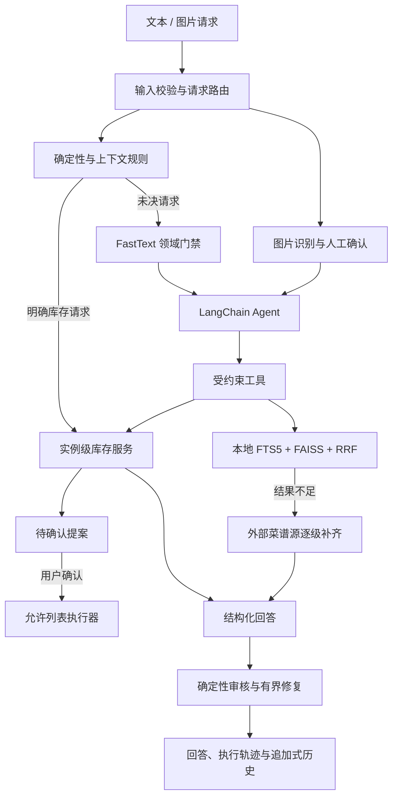

# Kitchen Inventory Agent

Kitchen Inventory Agent 是一个面向家庭厨房场景的可审计 Agent。它处理的不只是“记录食材名称”，还包括同名食材的不同批次、无法安全换算的自然语言数量、需要用户确认的库存变更、受过敏原约束的菜谱检索，以及烹饪前后持续变化的上下文。

系统将语言模型用于意图理解、候选选择和受约束的工具调用，将实例身份、原始数量、状态转换、确认执行与事实审核交给确定性代码。任何库存写操作都先生成持久化提案，用户确认后才会执行；主动建议只读，不会代替用户修改库存。

## 系统架构



这条链路围绕三个边界设计：

- **模型不直接写数据库**：Agent 只能调用预先定义的工具，库存写工具仅创建带真实状态预览的 `pending` 提案。
- **事实不依赖模型复述**：库存查询与提案结果由程序根据结构化工具输出生成，并再次接受字段级审核。
- **降级不绕过安全约束**：分类器、保质期推断、菜谱服务或修复流程不可用时，系统会保留请求、回退或返回安全结果，但不会跳过确认门。

## 核心能力

| 能力 | 当前实现 |
| --- | --- |
| 实例级库存 | 每次购入保存为独立 `instance_id`；同名批次不合并，查询、预览和回答均展示完整 ID |
| 原始数量表达 | `quantity_text` 作为不透明单行文本保存，不擅自解析、换算或累加“半袋”“约 400g–500g”等表达 |
| 保质期与校准 | 用户日期优先；否则使用结构化模型推断，无效结果安全回退为 `unknown`；`last_confirmed_at` 独立记录人工核对时间 |
| 确认式写入 | 新增、整项替换、单实例删除、同名批量删除和库存校准均先生成持久化提案，确认后才执行 |
| 请求路由 | 问候、明确库存指令和上下文追问优先走确定性规则；仍未决的纯文本再进入 FastText 领域门禁 |
| 图片识别 | 接入百度果蔬识别，校验格式、尺寸与长宽比，并按置信度接受、提醒确认或暂停等待人工选择 |
| 菜谱检索 | 本地 SQLite FTS5 与 FAISS 双路召回、RRF 融合；本地结果不足时依次由 Spoonacular、TheMealDB 和 DeepSeek Web Search 补齐 |
| 过敏原约束 | 官方类别确定性展开，自定义过敏原和排除食材进入结构化参数校验，并对返回标题、步骤和原料逐字段过滤 |
| Cooking Session | 每位用户维护一个活动烹饪 task；菜谱确认、份数调整、暂停切换和烹饪后库存核对均保留结构化状态 |
| 对话与画像 | 完整交互追加保存到 SQLite；Agent 自动注入最近 10 段相关对话；长期画像以版本化 Markdown 保存事实、证据与冲突状态 |
| 主动建议 | 页面访问间隔严格超过 24 小时时执行只读扫描，最多展示一句固定模板建议，不生成提案或后台通知 |
| 回答监督 | 确定性审核失败后，受限子 Agent 可重写一次，主 Agent最多重试一次，随后使用固定安全兜底 |
| 执行轨迹 | 请求按阶段记录路由、工具、外部服务、审核、修复和降级结果，并与最终回答一起持久化 |

### 库存状态与写入

库存实例包含以下核心字段：

```text
instance_id / name / quantity_text / stocked_at / expires_at /
expiry_source / last_confirmed_at
```

当前允许的库存操作为：

```text
inventory.add
inventory.replace
inventory.remove
inventory.remove_all
inventory.confirm
```

提案保存操作参数、目标实例和创建时的真实库存预览，默认有效期为 15 分钟。确认时，服务端会重新校验持久化预览并原子领取执行权；重复确认已执行提案只返回原结果，不重复写入。替换操作提交一份新的完整状态，不在数据库中进行部分扣减或单位运算。

### 菜谱检索与安全过滤

本地检索从 SQLite/FTS5 和 FAISS 各召回 top 100，使用 RRF `k=60` 融合，再执行过敏原与排除食材硬过滤。构建产物通过模型 revision、SHA-256、数据计数和向量维度校验；校验失败时不加载不完整的本地检索器，而是降级到外部菜谱源。

本地至少返回 3 条安全结果时停止外部请求；不足时保留已有结果并逐级补齐。跨来源按 URL、来源 ID 和规范化标题去重；所有来源都不足时只返回真实结果，不虚构菜谱。

### 记忆、任务与主动建议

完整对话按用户永久追加保存，短期上下文仅注入最近 10 段相关输入与输出；按时间召回可以查询更早记录。长期画像区分用户确认事实与自动推断事实，并保存证据、版本和审核事件。明确的长期偏好先生成画像提案，经用户确认后生效。

菜谱确认会创建结构化 Cooking Session。用户标记“已烹饪”后，系统进入库存核对：全部用完时生成删除提案，仍有剩余时生成整项替换提案；每项变更仍需单独确认。

主动建议只在页面访问时检查。系统按已过期、3 天内临期、超过 14 天未确认和可能缺货的顺序选择候选，最终只展示一条单行、100 个 Unicode 字符以内的固定模板文案。

### 回答审核与有界修复

只要工具历史中出现库存读取或提案，程序就会从结构化结果重新生成库存段落，避免模型省略完整 ID、改写数量或错误声称操作已经执行。菜谱回答同样校验工具调用、标题、原料、步骤与来源链接的一致性。

表达层问题可交给无工具的修复子 Agent 重写一次；若问题涉及缺少菜谱工具调用或结果不一致，则要求主 Agent 在受限模式下重试。任何路径都不能进行第三次生成、创建重复库存提案或改变既有工具记录。

## 验证与指标

项目提供可重复的分层评估，覆盖分类与路由、本地混合检索、确定性审核、修复子 Agent、Cooking Session 和端到端路径。最终证据见 [快速评测报告](evaluation/results/20260812T053146Z-final.md)。

### 结果概览

| 范围 | 证据类型 | 结果 |
| --- | --- | --- |
| 全量自动化测试 | `measured` | **484/484 通过**，耗时 **51.85 秒** |
| 完整离线评估 | `measured` | 全部评估成功，无 `skipped` 或 `unavailable` |
| 确定性审核器 | `fault_injection` | **30/30** 风险回答被拦截，**15/15** 合法回答被放行 |
| 快速评测分类器 | `measured` | 准确率 **96.30%**，食物召回率 **95.71%** |
| 路由挑战集 | `measured` | 食物误拦率 **21.74%**；作为后续增强重点保留 |
| 本地混合检索 | `measured` | RRF Recall@10 **93.33%**；总体 Recall 与最佳单路持平 |
| 双路检索互补性 | `measured` | FTS 贡献 **2** 个独占命中，FAISS 贡献 **1** 个独占命中 |
| 修复子 Agent | `measured` | **6/6** 有效决策：4 次成功重写，2 次正确要求主 Agent 重试 |
| 修复子 Agent 成本 | `measured` | 累计实际消耗 **3,658 tokens**，包含首次失败与定向补跑 |
| Cooking Session | `measured` | 事实保留率由仅依赖历史的 **20%** 提升至结构化状态的 **100%** |
| 分类拦截成本探针 | `paired_estimate` | 3 个在线样本中，每次拦截平均估算节省 **192.67 tokens** |
| 端到端路径 | `measured` | **12/12** 路径成功，使用隔离临时数据库且无网络调用 |

`fault_injection` 衡量已知风险样本的检出能力，不代表生产事故率；`paired_estimate` 是小样本成本估算，不外推为生产流量结论。检索目标来自本地已收录菜谱，因此更适合验证当前检索链路，而非代表开放域搜索效果。

### 分类器数据与效果

分类器训练读取 `classifier/dataset/` 下的规范 CSV，支持 UTF-8 逗号分隔和 GBK Tab 分隔。当前合并去重后共 1,621 条；部署模型使用训练集与验证集共 1,376 条重新训练，独立测试集不参与训练或阈值选择。

| 数据集 | 样本数 | 准确率 | 精确率 | 召回率 | 假阳性率 |
| --- | ---: | ---: | ---: | ---: | ---: |
| 验证集 | 242 | 100.00% | 100.00% | 100.00% | 0.00% |
| 独立测试集 | 245 | 93.88% | 84.81% | 95.71% | 6.86% |

该表是分类器自身的既有离线评估；上方 96.30% 是快速系统评测中的分类器结果，两者来自不同评估口径。系统通过“确定性路由优先、分类器处理未决请求”的组合降低对单一二分类边界的依赖。

### 复现评估

```bash
python -m pytest -q -s
python -m evaluation.run --suite quick --offline
python -m evaluation.run --suite quick
```

离线模式不发送网络请求。在线模式最多运行 3 个 DeepSeek 领域门禁成本探针和 6 个修复子 Agent 样本；Spoonacular 每轮运行最多调用 5 次。评估产物写入 `evaluation/results/`，同时保存逐样本 JSON 和 Markdown 报告。

## 当前边界与演进方向

| 方向 | 当前范围 | 演进方向 |
| --- | --- | --- |
| 数量语义 | 保存原始文本，整项替换，不做库存算术 | 引入可追溯的单位标准化、部分扣减与换算确认 |
| 写入一致性 | 提案原子领取，执行幂等 | 增加提案状态与库存写入之间的跨事务恢复协议 |
| 路由 | 确定性规则结合 FastText 门禁 | 扩充挑战样本，降低食品请求误拦率并增加显式不确定路径 |
| 图片恢复 | 持久化候选、人工修改与原请求恢复 | 增加恢复执行的原子领取与并发保护 |
| 菜谱知识 | 复合食材和过敏原硬过滤 | 扩充别名与衍生物知识，引入 reranker、营养约束和菜单规划 |
| 对话历史 | 追加保存、十段上下文、时间召回 | 增加关键词或语义检索、历史压缩和用户可控删除策略 |
| 主动能力 | 页面访问触发的只读建议 | 在保持确认边界的前提下扩展调度与通知渠道 |
| 产品化 | 固定 showcase 用户 | 增加账户体系、身份认证和多租户隔离 |

## 项目结构

```text
app/
├── actions.py                # 库存提案、状态转换与允许列表执行
├── adapters/                 # 菜谱、Web Search 与图片识别适配器
├── agent.py                  # LangChain Agent 与受约束工具
├── audit.py                  # 回答与工具结果审核
├── intent.py                 # 确定性路由与意图匹配
├── memory.py                 # 用户画像、追加式历史与时间召回
├── pipeline.py               # 顶层请求编排
├── proactive.py              # 访问节流与主动建议
├── supervisor.py             # 有界修复、重试与安全兜底
├── tasks.py                  # Cooking Session 状态管理
├── tools/                    # 库存仓库与菜谱路由
├── trace.py                  # 请求级执行轨迹
├── vision.py                 # 图片校验与置信度分层
└── web.py                    # FastAPI 接口

classifier/                   # FastText 数据、训练、评估与运行时
recommender/                  # SQLite/FTS5、FAISS 与 RRF 检索
evaluation/                   # 可重复的分层系统评估
frontend/                     # 展示页、库存、task 与执行轨迹
tests/                        # pytest 自动化测试
main.py                       # CLI 入口
```

## 数据集与模型

| 类型 | 项目 | 用途 | 固定版本 | 许可 |
| --- | --- | --- | --- | --- |
| 数据集 | [MASSIVE](https://huggingface.co/datasets/AmazonScience/massive) | 分类器中文领域外文本 | `AmazonScience/massive`，本地保留 `zh-CN` 分区 | CC BY 4.0 |
| 数据集 | [recipe-dataset](https://github.com/josephrmartinez/recipe-dataset) | 本地菜谱检索语料 | commit `c5a1e8dab69d46841d914be1f20cca6fbe4b6260` | CC BY-SA 3.0 |
| 模型 | [BAAI/bge-small-en-v1.5](https://huggingface.co/BAAI/bge-small-en-v1.5) | 384 维菜谱 embedding | revision `5c38ec7c405ec4b44b94cc5a9bb96e735b38267a` | MIT |

## 安装与运行

项目需要 Python 3.11 或更高版本。

```bash
python3.13 -m venv .venv
.venv/bin/python -m pip install -r requirements.txt
cp .env.example .env
```

启动 Web 展示页：

```bash
./scripts/start.sh
```

访问 `http://127.0.0.1:8000`；OpenAPI 文档位于 `http://127.0.0.1:8000/docs`。停止服务或指定端口：

```bash
./scripts/stop.sh
./scripts/start.sh --port 8080
./scripts/stop.sh --port 8080
```

CLI 示例：

```bash
.venv/bin/python main.py \
  --text "查询一下当前库存" \
  --user-id "demo-user" \
  --language zh
```

## 关键配置

| 变量 | 默认值 | 用途 |
| --- | --- | --- |
| `DEEPSEEK_API_KEY` | 空 | Agent、保质期推断、主动候选选择与 Web Search 兜底 |
| `DEEPSEEK_MODEL` | `deepseek-v4-flash` | OpenAI 兼容模型名称 |
| `BAIDU_IMAGE_API_KEY` / `BAIDU_IMAGE_SECRET_KEY` | 空 | 图片食材识别 |
| `SPOONACULAR_API_KEY` | 空 | 可选主菜谱源 |
| `INVENTORY_DB_PATH` | `data/inventory.db` | 库存、提案、历史、访问时间与图片确认数据库 |
| `USER_PROFILE_PATH` | `data/user_profile.md` | 长期用户画像 |
| `FOOD_CLASSIFIER_MODEL_PATH` | `classifier/artifacts/food_query.bin` | FastText 模型 |
| `RECOMMENDER_DB_PATH` | `recommender/artifacts/recipes.db` | 本地 SQLite/FTS5 索引 |
| `RECOMMENDER_FAISS_PATH` | `recommender/artifacts/recipes.faiss` | 本地 FAISS 索引 |
| `APP_TIMEZONE` | `Asia/Shanghai` | 相对时间解释使用的 IANA 时区 |

完整配置及默认值见 [.env.example](.env.example)。

## 主要 API

| 方法 | 路径 | 用途 |
| --- | --- | --- |
| `POST` | `/api/process` | 处理文本或图片请求 |
| `GET` | `/api/inventory` | 获取库存实例快照 |
| `GET` | `/api/actions` | 获取待确认库存提案 |
| `POST` | `/api/actions/{action_id}/confirm` | 确认并执行库存提案 |
| `POST` | `/api/actions/{action_id}/cancel` | 取消库存提案 |
| `GET` | `/api/tasks` | 获取活动、暂停和待核对 task |
| `POST` | `/api/tasks/recipe` | 从持久化菜谱证据创建或更新 task |
| `POST` | `/api/tasks/{task_id}/cooked` | 完成烹饪并开启库存核对 |
| `POST` | `/api/proactive-check` | 记录访问并返回只读建议或 `null` |
| `GET` / `PUT` | `/api/allergens` | 获取或更新过敏原设置 |
| `POST` | `/api/vision-confirmations/{confirmation_id}/resolve` | 确认图片候选并恢复原请求 |

当前 Web 展示使用固定 showcase 用户；底层库存提案、历史、任务、访问记录和图片确认均按 `user_id` 保存或校验。

## 分类器训练

训练脚本使用 FastText 0.9.2 CLI；应用内推理使用与 `.bin` 文件兼容的 `fasttext-predict`。

```bash
./classifier/build_fasttext.sh
.venv/bin/python -m classifier.train
.venv/bin/python -m classifier.evaluate \
  --dataset classifier/dataset/semantic_food_query_dataset_300.csv
```
