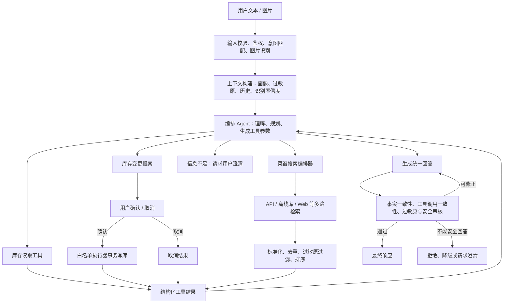

# Kitchen Inventory Agent

以 Python 和 LangChain 为核心的厨房库存 Agent

当前仓库实现以下链路：



补充行为：

- 图片识别结果按置信度处理：中置信度结果进入上下文并强制附带核对提醒；低置信度结果先进入持久化人工校对点，确认后恢复原请求。
- 最终输出经过正则审核和确定性工具调用审核，核对库存提案、工具参数、菜谱来源及图片确认状态。
- 对话历史存入 SQLite，仅保留每个用户最近 5 段。每段只保存当前轮请求、最终回答、工具记录和确认结果，不嵌套旧历史。

## 目录

```text
app/             Python 主包
app/adapters/    外部 API 适配器
app/tools/       Agent 可调用工具
classifier/      食谱/食材相关性 FastText 二分类器
data/            SQLite 库存数据库及用户画像
frontend/        前端
scripts/         PowerShell 启动与停止脚本
tests/           测试
```

## 初始化

```powershell
python -m venv .venv
.venv\Scripts\Activate.ps1
pip install -r requirements.txt
Copy-Item .env.example .env
```

## 文本分类器

项目使用 FastText 监督二分类器作为文本请求的领域门禁：食谱、食材、库存、
保存、安全、过敏原及烹饪问题标记为正类，其他问题标记为负类。图片请求不经过
该文本分类器。模型不可用或加载失败时采用 fail-open 策略，请求会继续进入原有
Agent 流水线，并在执行轨迹中记录降级状态。

当前模型使用 300 条样本，按类别以固定随机种子 `42` 划分为 210 条训练集、
44 条验证集和 46 条测试集；部署模型使用训练集与验证集共 254 条样本重新训练。
文本采用 NFKC 规范化、英文小写及 jieba 分词，主要训练参数如下：

| 参数 | 配置 |
| --- | ---: |
| 学习率 (`lr`) | 0.2 |
| 训练轮数 (`epoch`) | 100 |
| 词 N-gram (`wordNgrams`) | 2 |
| 向量维度 (`dim`) | 100 |
| 字符 N-gram (`minn` / `maxn`) | 1 / 4 |
| 哈希桶 (`bucket`) | 50000 |
| 损失函数 (`loss`) | softmax |

分类阈值在验证集上以正类召回率不低于 98% 为约束选取，当前模型效果如下：

| 数据集 | 样本数 | 准确率 | 精确率 | 召回率 | 假阳性率 |
| --- | ---: | ---: | ---: | ---: | ---: |
| 验证集 | 44 | 88.64% | 81.48% | 100.00% | 22.73% |
| 独立测试集 | 46 | 80.43% | 75.00% | 91.30% | 30.43% |

在 `.env` 中填写密钥后运行

启动展示页面：

```powershell
.\scripts\start.ps1
```

然后访问 `http://127.0.0.1:8000`

停止应用：

```powershell
.\scripts\stop.ps1
```
