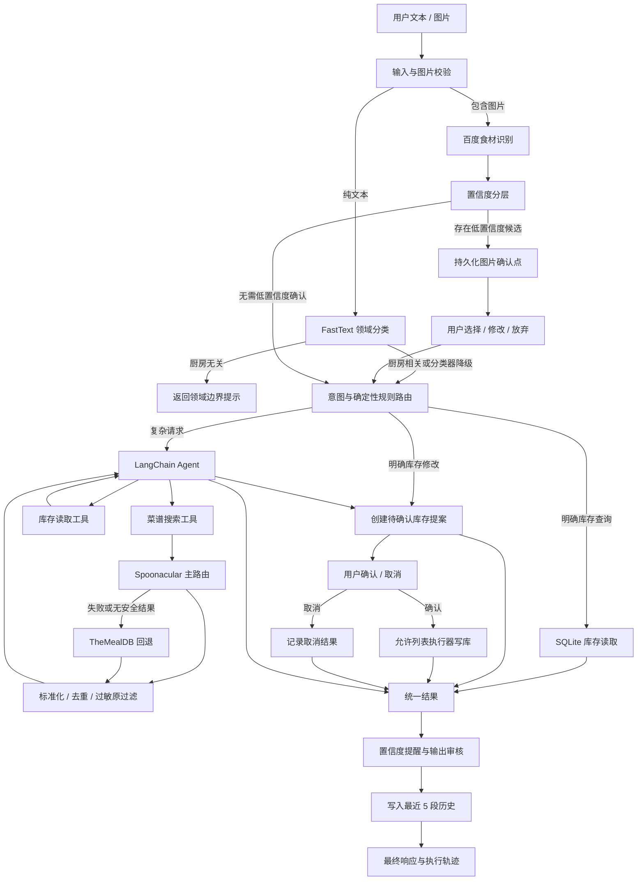

# Kitchen Inventory Agent

Kitchen Inventory Agent 是一个围绕厨房库存、图片食材识别和在线菜谱检索构建的智能助手。系统使用 LangChain Agent 理解复杂请求并组织工具调用，同时将库存写入、图片低置信度处理、过敏原约束和输出一致性检查放在确定性代码中执行。

项目重点展示一条可运行、可确认、可审查的 Agent 请求链路：用户既可以查询和维护本地库存，也可以上传食材图片、搜索在线菜谱，并在前端查看请求经过的分类、工具、确认和审核步骤。

## 核心能力

| 能力 | 当前实现 |
| --- | --- |
| 领域分类 | 使用 FastText 监督二分类器识别食谱／食材相关请求；模型不可用或预测失败时记录降级并 fail-open |
| 图片识别 | 接入百度果蔬识别 API，校验图片格式、尺寸和长宽比，并按置信度分层处理识别结果 |
| 人工确认 | 低置信度图片候选持久化到 SQLite，用户可选择、修改或放弃，确认后恢复原请求 |
| 库存查询 | 使用 SQLite 保存库存，支持列表查询和按名称查询；部分明确指令可通过确定性规则直接执行读取流程 |
| 库存写入 | 新增、修改和删除均先创建允许列表内的持久化提案，只有用户确认后才执行写库 |
| 菜谱检索 | Spoonacular 作为主检索源，TheMealDB 作为回退源；统一返回菜谱标题、原料、步骤、来源和链接 |
| 过敏原约束 | 区分 Spoonacular 官方 intolerance 和自定义过敏食材，调用菜谱工具时检查过滤条件是否完整 |
| 对话记忆 | 将请求、最终回答、工具记录和确认结果写入 SQLite，每个用户保留最近 5 段非递归历史 |
| 输出审核 | 使用正则规则和工具调用记录检查虚假执行声明、库存数值、菜谱来源和图片确认状态 |
| 执行轨迹 | 记录分类、路由、外部 API、数据库、模型和审核阶段的状态、摘要与耗时，并在前端展示 |

## 系统架构



系统没有让语言模型直接执行任意数据库写入。Agent 只能调用预先定义的工具；库存变更工具本身也只生成待确认提案，实际写库由独立的允许列表执行器完成。

## 已实现功能

### 1. FastText 领域分类与请求路由

纯文本请求首先经过食谱／食材领域二分类器。正类覆盖食谱、食材库存、食材保存、食品安全、过敏原和烹饪问题；负类覆盖餐厅外卖、厨电维修、餐饮经营及其他非食品问题。图片请求会跳过文本分类器，直接进入图片处理链路。

分类器包含完整的训练和推理流程：

- 对文本执行 NFKC 规范化、英文小写和 jieba 分词；
- 使用 FastText supervised 模型和 softmax 损失；
- 按类别使用固定随机种子 `42` 进行 70% / 15% / 15% 划分；
- 在验证集上选择满足正类召回率不低于 98% 的分类阈值；
- 使用训练集和验证集重新训练部署模型；
- 保存模型、元数据、数据集摘要和独立测试集指标。

应用启动时只加载一次模型。模型文件缺失、版本不兼容或预测异常时，请求不会因分类器故障而中断，而是继续进入后续流程，并在执行轨迹中记录 `unavailable` 或 `fail-open`。

目前领域分类发生在库存正则路由和订单意图判断之前。分类器已经能够承担统一领域门禁，但白名单、黑名单和语义判断之间更细粒度的优先级仍可继续完善。

### 2. 图片识别、置信度分层与人工确认

图片进入外部识别 API 前会执行以下确定性校验：

- 最大文件大小为 3 MiB；
- 只接受 JPEG、PNG 和 BMP；
- 图片边长必须在 15–4096 px；
- 长宽比不得超过 3:1；
- 使用 Pillow 验证图片内容可正常解码。

百度识别结果根据两个阈值划分为三类：

| 置信度 | 状态 | 处理方式 |
| --- | --- | --- |
| `>= 0.85` | `accepted` | 直接进入当前请求上下文 |
| `>= 0.50` 且 `< 0.85` | `needs_confirmation` | 可以进入上下文，但最终回答由程序确定性追加核对提醒 |
| `< 0.50` | `rejected` | 暂不进入 Agent，先创建持久化人工确认点 |

低置信度确认点保存原始请求、目标语言、全部识别结果、有效期和处理状态。前端允许用户：

- 选择需要采用的候选；
- 修改候选食材名称；
- 不选择某个候选，从后续上下文中放弃该结果；
- 一次放弃全部低置信度候选。

确认后，选中的食材以 `user_confirmed` 状态恢复到上下文，未选择的候选被记录为 `dropped`，系统随后继续处理原始请求。已完成确认会保存最终处理结果，重复读取同一已完成确认时可返回已保存结果。

### 3. SQLite 库存与两阶段写入

库存使用 SQLite 表保存食材名称、数量和单位，当前支持：

- 列出全部库存；
- 按精确食材名称读取；
- 新增库存并对同单位食材累加；
- 设置库存数量和单位；
- 部分扣减库存；
- 删除整项库存。

明确的库存查询和部分格式固定的写入请求可以由正则路由直接处理，减少不必要的模型调用。复杂表达则由 Agent 选择相同的库存工具。

所有写操作均采用“提案—确认—执行”流程：

1. 校验操作是否属于 `inventory.add`、`inventory.update`、`inventory.remove` 允许列表；
2. 使用 Pydantic 校验参数类型、数值范围和额外字段；
3. 将提案以 `pending` 状态写入 SQLite，并设置过期时间；
4. 用户可以确认或取消提案；
5. 确认时通过 `BEGIN IMMEDIATE` 获取执行权，并将状态切换为 `executing`；
6. 执行库存变更后保存结构化结果，状态切换为 `executed`；
7. 重复确认已执行提案时返回原结果，不会再次扣减或增加库存。

提案还支持 `cancelled`、`expired` 和 `failed` 状态，并校验提案所属用户。当前提案状态转换与库存修改分别使用 SQLite 事务；跨步骤的崩溃恢复、操作前后快照和更完整的追加式审计记录仍有进一步增强空间。

### 4. LangChain Agent 与工具边界

复杂请求由基于 `ChatOpenAI` 兼容接口的 DeepSeek 模型处理，并通过 LangChain `create_agent` 组织工具调用。当前提供六个 Agent 工具：

```text
list_inventory
get_inventory_item
propose_add_inventory_item
propose_update_inventory_item
propose_remove_inventory_item
search_recipes
```

Agent 负责理解用户意图、将食材或筛选条件转换为工具参数、结合工具结果组织回答；确定性代码负责参数模型、工具允许列表、库存确认、过敏原完整性检查、图片状态检查和最终输出审核。

Agent 设置了最大输入字符数、最大输出 Token、HTTP 超时、有限重试和递归上限。超过输入限制的上下文会在调用模型前被拒绝。

当前 Agent 会在工具调用过程中隐式决定下一步，但尚未生成独立的结构化 Plan、任务依赖图或可由前端展示的步骤状态。

### 5. Spoonacular 与 TheMealDB 菜谱路由

菜谱工具要求至少提供一个英文食材参数。检索流程为：

1. 配置 Spoonacular 密钥时，优先调用 `/recipes/complexSearch`；
2. 将食材、diet、cuisine、meal type、最大制作时间、排序方式和过敏原转换为 API 参数；
3. 标准化标题、步骤、原料、来源 URL 和图片 URL；
4. 对结果执行去重和过敏原字符串过滤；
5. Spoonacular 失败或没有安全结果时，使用 TheMealDB 搜索第一个食材并读取菜谱详情；
6. 对回退结果执行相同的去重和过敏原过滤。

Spoonacular 当前支持 `max-used-ingredients` 和 `min-missing-ingredients` 两种 API 排序方式。系统还没有实现本地菜谱数据集、关键词与向量双路召回或多因素融合排序，因此当前菜谱质量主要依赖外部 API 的候选和排序。

### 6. 结构化过敏原约束

用户画像将过敏原分为两类：

- Spoonacular 官方支持的 12 类 intolerance，例如 `Dairy`、`Peanut`、`Shellfish` 和 `Tree Nut`；
- 用户自定义的具体过敏食材，例如腰果、虾皮或香菜。

前端可以读取和更新两类配置。调用菜谱工具时，确定性代码要求：

- 所有已配置官方过敏原必须完整传入 `intolerances`；
- 每个自定义过敏食材都必须提供原文和英文 API 食材名的对应关系；
- 自定义原文不能被遗漏或替换成未配置项目；
- 所有面向英文菜谱 API 的查询词必须符合英文格式；
- 自定义过敏食材的英文名称会合并到 `excludeIngredients`；
- API 返回后再次扫描标题、步骤和原料，排除包含过敏原词项的菜谱。

这套流程已经把“是否遗漏已配置过敏原”从 Prompt 要求提升为工具级校验。不过，自定义食材的英文映射仍由模型生成，当前也没有独立的食材归一化、别名与衍生物知识库；对复杂配料和未知成分的覆盖仍可继续提升。

### 7. 用户画像与五段对话记忆

长期用户画像保存在 Markdown 中，当前可以读取饮食偏好、官方过敏原和自定义过敏食材。过敏原可通过前端 API 双向更新，饮食偏好目前主要作为只读上下文使用。

对话历史使用 SQLite 独立保存，每段包含：

```json
{
  "request": "本轮用户请求",
  "response": "本轮最终回答",
  "tool_history": [],
  "confirmation_result": null
}
```

每个用户最多保留最近 5 段。历史记录只保存当前轮数据，不会把提供给 Agent 的旧历史再次写入新记录，从而避免上下文递归膨胀。构建 Agent 上下文时，旧版 Markdown 中的静态“历史摘要”也会被剔除。

库存确认结果和完成后的图片确认结果会写入历史。领域分类阶段直接拦截的请求和等待图片确认时的中间响应目前不会形成完整历史段；如果需要覆盖全部入口结果，可以进一步统一早期返回路径的持久化策略。

### 8. 确定性输出与工具调用审查

最终回答会经过两层确定性检查。

第一层是正则审查，当前阻止：

- 提示注入式的“忽略之前／以上指令”文本；
- 在系统不支持订单支付时声称“已经付款”或“已经下单”；
- 空回答。

第二层根据工具调用历史检查回答与真实记录的一致性，包括：

- 低置信度图片结果是否绕过确认进入 Agent；
- 中置信度结果是否包含程序生成的核对提醒；
- `user_confirmed` 食材是否能在确认记录中找到；
- 工具参数和结果是否为预期结构；
- 库存提案参数是否与提案结果一致；
- 待确认库存操作是否被错误描述为已经执行；
- 回答中的库存数量和单位是否与查询结果一致；
- 推荐的菜谱标题和链接是否来自 `search_recipes` 返回结果。

检查失败时，系统会拦截原回答并返回统一提示。当前审核器采用确定性规则，没有调用独立审核模型；事实审查也集中在库存、菜谱来源和图片确认等关键字段，尚未覆盖任意自然语言陈述和菜谱步骤中的所有细节。

### 9. 可视化执行轨迹

每次请求使用请求级 `TraceRecorder` 记录：

```text
stage / name / status / detail / duration_ms
```

当前轨迹覆盖输入校验、领域分类、意图匹配、图片识别、人工确认点、库存读写、菜谱 API、DeepSeek Agent、正则审核和工具调用审核。异常轨迹只保存异常类型和安全摘要，避免将密钥或外部服务原始响应发送到浏览器。

前端按实际执行顺序展示每条轨迹及耗时。轨迹目前随请求结果返回，没有独立的跨请求统计存储，也不包含模型 Token、费用或首字延迟统计。

## 关键设计说明

### 模型负责理解，代码负责约束

系统将自然语言理解、英文 API 参数生成和最终语言组织交给模型；将写操作权限、用户确认、数据校验、过敏原完整性、置信度提醒和结果一致性放在代码中。这样可以保留 Agent 的表达与编排能力，同时降低仅依赖 Prompt 约束关键操作的风险。

### 可恢复的人工确认点

图片确认和库存提案都不依赖内存中的临时对象，而是保存到 SQLite。服务重新创建 Pipeline 后仍可以根据确认 ID 读取待处理数据。库存确认使用原子状态领取避免重复执行；图片确认会保存最终结果，但在继续原请求前还没有同等级别的原子领取步骤，并发恢复保护仍可增强。

### 有界上下文

系统不把全部聊天内容持续追加到 Prompt，而是按用户读取最近 5 段结构化历史。每段历史中的工具记录和确认结果可以帮助 Agent 理解近期操作，同时固定窗口限制上下文长度。

### 外部服务降级

分类器加载失败时采用 fail-open，避免辅助门禁成为单点故障；Spoonacular 失败或没有安全结果时回退到 TheMealDB；工具和 API 异常会记录在执行轨迹中，并转换为不包含密钥和原始服务响应的用户提示。

## 验证与指标

### 自动化测试

当前测试套件包含 **46 项通过测试**，主要覆盖模块和 HTTP 接口行为：

- 库存 CRUD、非法数量和部分扣减；
- 提案在确认前不写库、重复确认幂等、取消后不可执行、跨用户禁止；
- 简单库存读写路由和分类器 fail-open；
- 图片格式、尺寸、置信度阈值和百度 API 参数；
- Spoonacular 参数映射、TheMealDB 回退和过敏原过滤；
- Agent 输入限制和过敏原工具参数约束；
- 用户画像读写、HTTP 输入限制、执行轨迹和审核正则。

这些测试验证了关键模块和部分接口组合行为。图片确认完整恢复、五段历史裁剪、工具调用审核的全部规则、并发状态转换和多轮 Agent 场景仍需要更系统的端到端场景覆盖。

运行测试：

```powershell
.venv\Scripts\python.exe -m pytest -q
```

### 分类器数据与效果

当前数据集包含 300 条查询，部署模型使用训练集和验证集共 254 条样本重新训练，独立测试集不参与训练或阈值选择。

| 数据集 | 样本数 | 准确率 | 精确率 | 召回率 | 假阳性率 |
| --- | ---: | ---: | ---: | ---: | ---: |
| 验证集 | 44 | 88.64% | 81.48% | 100.00% | 22.73% |
| 独立测试集 | 46 | 80.43% | 75.00% | 91.30% | 30.43% |

数据划分如下：

| 用途 | 样本数 |
| --- | ---: |
| 初始训练集 | 210 |
| 验证集 | 44 |
| 独立测试集 | 46 |
| 部署模型训练集 | 254 |

已实现的 FastText 二分类器可以为系统提供统一领域门禁；但是由于当前数据集规模较小，独立测试集准确率约 80.43%、假阳性率约 30.43%，分类边界仍有待进一步提升。后续可以增加困难负样本和边界正样本、按错误类型分析假阳性与假阴性，并为低分差结果增加显式“不确定”路径。

## 当前能力边界与提升空间

### 已有基础仍可继续增强

| 方向 | 当前基础 | 提升空间 |
| --- | --- | --- |
| 领域门禁 | FastText 模型、训练脚本、阈值选择、离线评估和 fail-open 已完成 | 扩充数据、补充错误分析，并优化白名单／黑名单与语义分类的执行顺序 |
| 图片确认 | 低置信度候选持久化、编辑／放弃、原请求恢复和结果保存已完成 | 为恢复执行增加原子领取和更完整的并发测试 |
| 库存事务 | 提案、过期、取消、幂等确认、用户隔离和失败状态已完成 | 加强提案状态与库存变更的跨步骤原子性、快照和追加式审计记录 |
| 过敏原安全 | 官方类别、自定义排除、工具参数完整性检查和结果过滤已完成 | 增加食材名称归一化、别名、衍生物和未知成分规则 |
| 对话记忆 | SQLite 双向历史、最近 5 段窗口和非递归保存已完成 | 统一领域拦截等早期返回路径，并区分长期偏好、短期对话和业务事件 |
| 工具审核 | 库存、菜谱来源、执行状态和图片确认的确定性检查已完成 | 扩大参数语义和自然语言事实覆盖，并增加针对每条规则的回归测试 |
| 执行轨迹 | 前后端已展示请求阶段、状态、摘要和耗时 | 增加持久化统计、Token／成本和跨请求成功率分析 |

### 当前尚未包含的能力

以下模块尚未进入当前运行链路：

- **显式 Plan 与任务图**：当前 LangChain Agent 在调用工具时进行隐式编排，但没有独立 Plan 对象、步骤依赖关系和前端进度模型。
- **独立审核 Agent**：代码保留了二次模型审核接口位置，目前最终输出由正则和确定性工具记录审核完成。
- **本地菜谱检索**：尚未引入本地菜谱数据集、关键词搜索、向量搜索和融合排序。
- **食材信息与营养 API**：尚未接入 Edamam 等食材标准化或营养数据库；Spoonacular 当前也未请求营养字段。
- **通用网页搜索**：在线数据源目前限定为 Spoonacular 和 TheMealDB 两条菜谱专用路由。
- **多日菜单与营养约束规划**：当前提供单次菜谱检索，没有 CP-SAT／MILP 菜单求解、增量重规划或鲁棒库存约束。
- **菜谱到库存的烹饪闭环**：菜谱结果和库存工具均已存在，但尚未根据份数、替换食材和实际用量自动生成整组扣减提案。
- **主动库存管理**：库存记录当前没有保质期、估计区间和主动提醒调度，因此尚不能计算临期、浪费或补货优先级。
- **用户画像候选更新**：过敏原可由用户直接修改，饮食偏好等信息尚未由 Agent 提取候选并经确认写回。

这些能力边界明确区分了当前可运行链路与后续可扩展模块，便于在不改变现有工具接口的情况下逐步增加规划、检索和状态能力。

## 项目结构

```text
app/
├── actions.py                # 库存变更提案、状态和确认执行
├── adapters/
│   ├── recipe_api.py         # Spoonacular / TheMealDB 适配器
│   └── vision_api.py         # 百度果蔬识别适配器
├── agent.py                  # LangChain Agent 与工具定义
├── audit.py                  # 正则和工具调用记录审核
├── config.py                 # 环境变量配置
├── context.py                # Agent 上下文和响应模型
├── intent.py                 # 确定性意图与库存指令匹配
├── memory.py                 # 用户画像和五段对话历史
├── pipeline.py               # 顶层请求编排
├── tools/
│   ├── inventory.py          # SQLite 库存仓库
│   └── recipe.py             # 菜谱主备路由与过滤
├── trace.py                  # 请求级执行轨迹
├── vision.py                 # 图片校验和置信度分层
├── vision_confirmations.py   # 图片确认持久化
└── web.py                    # FastAPI 接口

classifier/
├── artifacts/                # 部署模型、元数据和评估结果
├── dataset/                  # 领域分类数据集
├── data.py                   # 数据校验和划分
├── evaluate.py               # 独立评估入口
├── model.py                  # 运行时分类器
├── preprocessing.py          # 文本预处理
└── train.py                  # 训练与阈值选择

data/                         # SQLite 数据库和 Markdown 用户画像
frontend/                     # 展示页面、样式和前端交互
scripts/                      # PowerShell 启停脚本
tests/                        # pytest 测试
main.py                       # CLI 入口
```

## 环境要求与安装

项目使用 `enum.StrEnum`，需要 **Python 3.11 或更高版本**。

PowerShell：

```powershell
python -m venv .venv
.venv\Scripts\Activate.ps1
pip install -r requirements.txt
Copy-Item .env.example .env
```

## 配置

环境变量集中定义在 `.env` 中。

### Agent 配置

| 变量 | 默认值 | 说明 |
| --- | --- | --- |
| `DEEPSEEK_API_KEY` | 空 | 复杂 Agent 请求所需；简单库存正则路由无需调用模型 |
| `DEEPSEEK_MODEL` | `deepseek-v4-flash` | OpenAI 兼容模型名称 |
| `DEEPSEEK_BASE_URL` | `https://api.deepseek.com` | 模型 API 地址 |
| `DEEPSEEK_MAX_OUTPUT_TOKENS` | `800` | 单次模型最大输出 Token |
| `DEEPSEEK_MAX_INPUT_CHARS` | `12000` | Agent 结构化输入字符上限 |
| `AGENT_RECURSION_LIMIT` | `10` | LangChain Agent 递归上限 |

### 外部服务配置

| 变量 | 默认值 | 说明 |
| --- | --- | --- |
| `BAIDU_IMAGE_API_KEY` | 空 | 图片食材识别所需 |
| `BAIDU_IMAGE_SECRET_KEY` | 空 | 图片食材识别所需 |
| `BAIDU_IMAGE_ENDPOINT` | 百度果蔬识别接口 | 图片识别地址 |
| `SPOONACULAR_API_KEY` | 空 | 可选主菜谱源；未配置时直接使用 TheMealDB |
| `SPOONACULAR_BASE_URL` | `https://api.spoonacular.com` | Spoonacular API 地址 |
| `THEMEALDB_API_KEY` | `1` | TheMealDB API 路径密钥 |
| `THEMEALDB_BASE_URL` | `https://www.themealdb.com/api/json/v1` | TheMealDB API 地址 |
| `HTTP_TIMEOUT_SECONDS` | `20` | 外部 HTTP 和模型请求超时 |

### 本地状态与分类器

| 变量 | 默认值 | 说明 |
| --- | --- | --- |
| `INVENTORY_DB_PATH` | `data/inventory.db` | 库存、提案、历史和图片确认 SQLite 文件 |
| `USER_PROFILE_PATH` | `data/user_profile.md` | Markdown 用户画像路径 |
| `PENDING_ACTION_TTL_MINUTES` | `15` | 库存提案和图片确认有效期 |
| `FOOD_CLASSIFIER_ENABLED` | `true` | 是否启用领域分类器 |
| `FOOD_CLASSIFIER_MODEL_PATH` | `classifier/artifacts/food_query.bin` | FastText 模型路径 |
| `FOOD_CLASSIFIER_METADATA_PATH` | `classifier/artifacts/metadata.json` | 分类阈值和预处理版本元数据 |

## 运行方式

### Web 展示页

```powershell
.\scripts\start.ps1
```

访问 `http://127.0.0.1:8000`。页面包含：

- 文本和图片请求输入；
- 图片低置信度确认；
- 库存快照；
- 待确认库存操作；
- 过敏原设置；
- 后端执行轨迹。

停止服务：

```powershell
.\scripts\stop.ps1
```

可以指定端口：

```powershell
.\scripts\start.ps1 -Port 8080
.\scripts\stop.ps1 -Port 8080
```

### CLI

```powershell
.venv\Scripts\python.exe main.py `
  --text "查询一下当前库存" `
  --user-id "demo-user" `
  --language zh
```

图片请求：

```powershell
.venv\Scripts\python.exe main.py `
  --text "根据图片里的食材推荐菜谱" `
  --image ".\sample.jpg" `
  --user-id "demo-user" `
  --language zh
```

CLI 会输出完整 JSON 结果。需要继续图片确认或库存提案时，可以使用对应 HTTP 接口或展示页完成交互。

## HTTP API

FastAPI 同时提供 OpenAPI 文档：`http://127.0.0.1:8000/docs`。

| 方法 | 路径 | 用途 |
| --- | --- | --- |
| `GET` | `/api/status` | 查看服务配置状态和输入限制 |
| `POST` | `/api/process` | 处理文本或图片请求 |
| `GET` | `/api/inventory` | 获取库存快照 |
| `GET` | `/api/allergens` | 获取过敏原选项和当前设置 |
| `PUT` | `/api/allergens` | 更新官方和自定义过敏原 |
| `GET` | `/api/actions` | 获取待确认库存提案 |
| `POST` | `/api/actions/{action_id}/confirm` | 确认并执行库存提案 |
| `POST` | `/api/actions/{action_id}/cancel` | 取消库存提案 |
| `POST` | `/api/vision-confirmations/{confirmation_id}/resolve` | 提交图片候选选择并恢复原请求 |

当前展示接口使用固定的 showcase 用户标识，没有包含账户注册、登录和多租户鉴权模块。底层提案、历史和图片确认仓库仍保存并检查 `user_id`，便于在扩展身份层时保持业务记录隔离。

## 分类器训练与评估

训练脚本使用 FastText 0.9.2 CLI；应用内推理使用与 `.bin` 文件兼容的 `fasttext-predict`。

Windows PowerShell 构建 FastText：

```powershell
.\classifier\build_fasttext.ps1
```

训练：

```powershell
.venv\Scripts\python.exe -m classifier.train
```

独立评估：

```powershell
.venv\Scripts\python.exe -m classifier.evaluate `
  --dataset classifier\dataset\semantic_food_query_dataset_300.csv
```

生成的部署文件位于 `classifier/artifacts/`，应用运行只依赖 `food_query.bin` 和 `metadata.json`。
