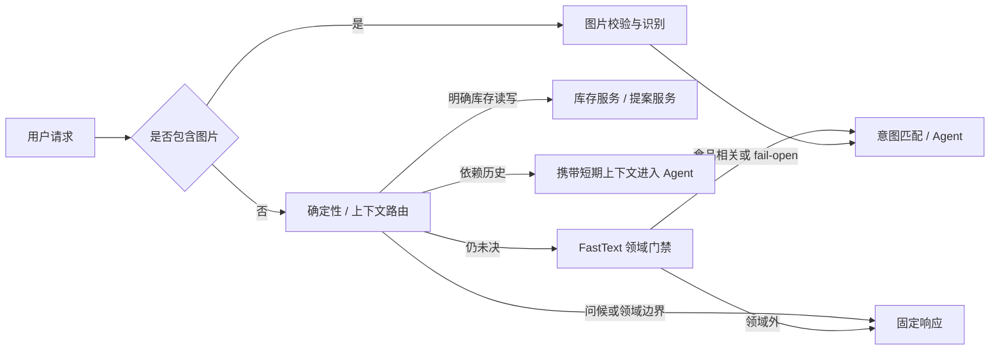
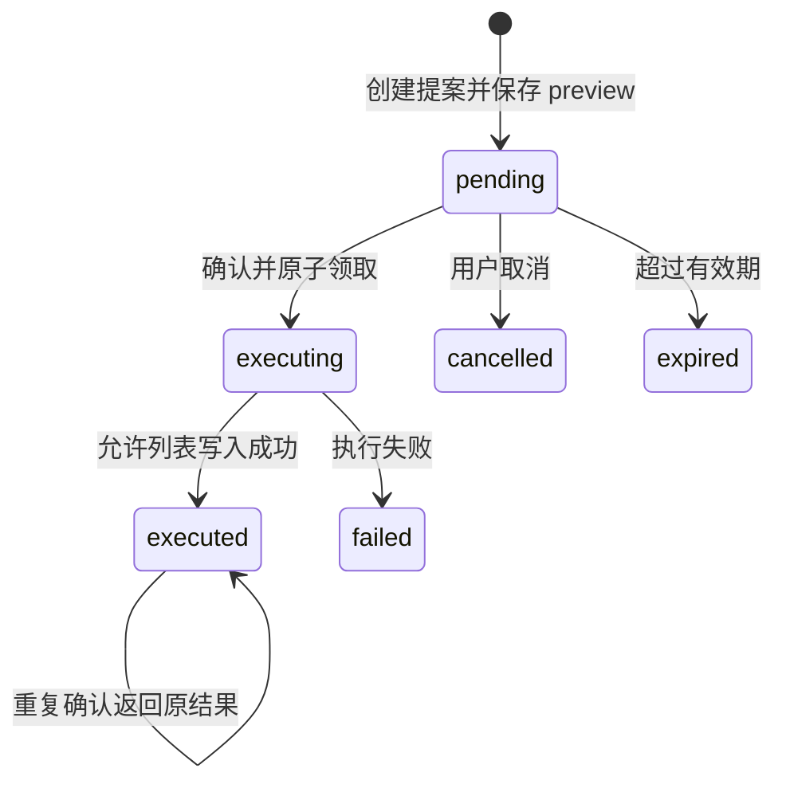
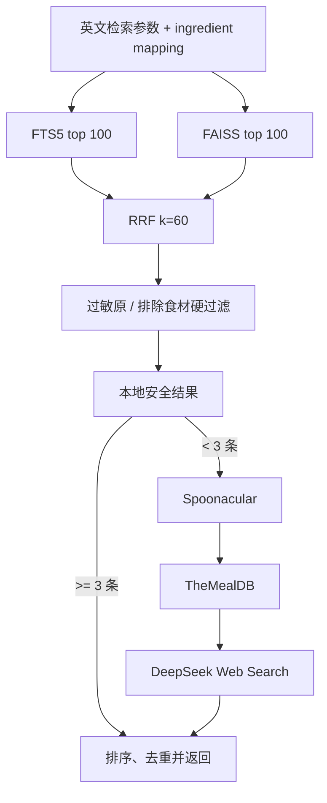
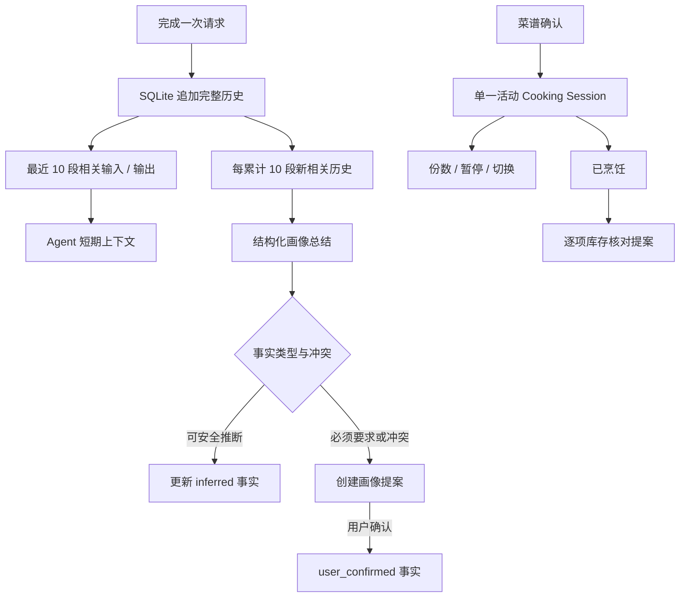
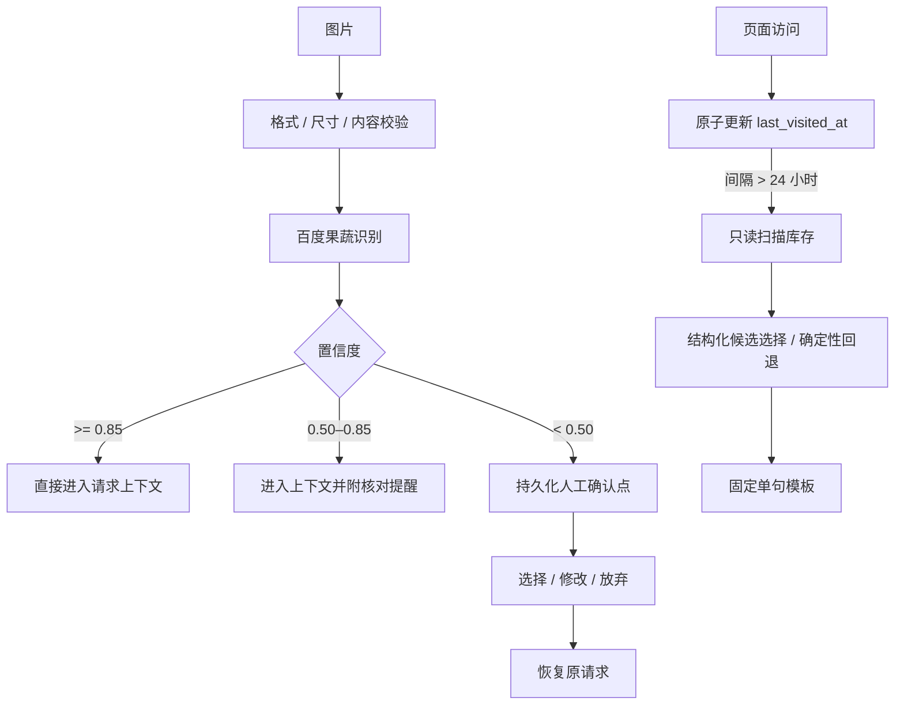
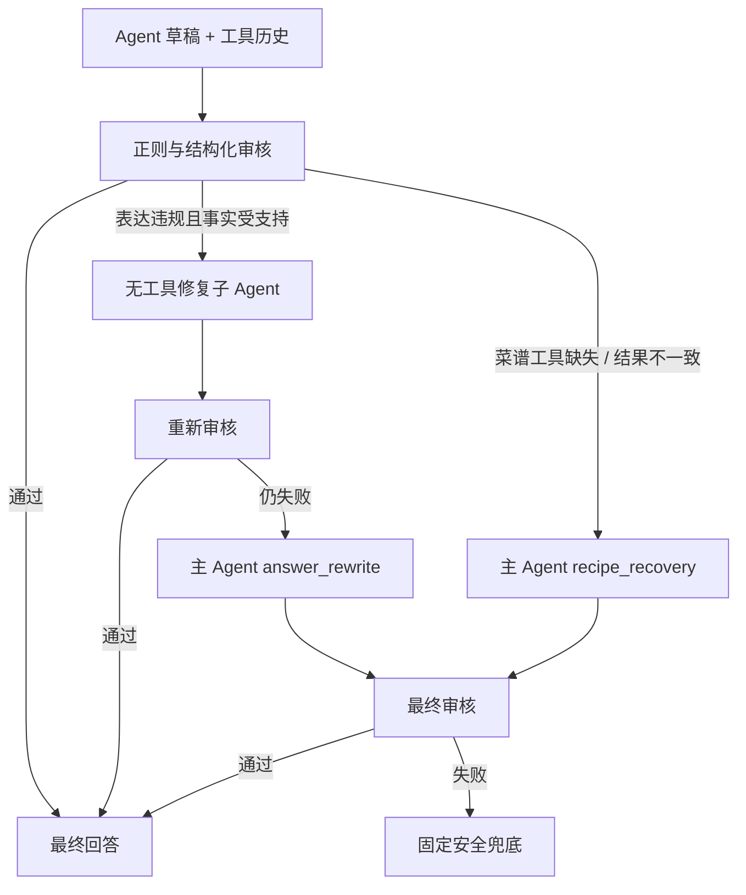
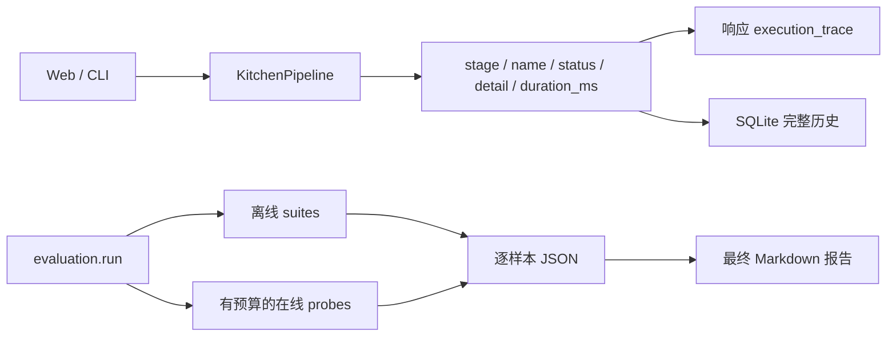
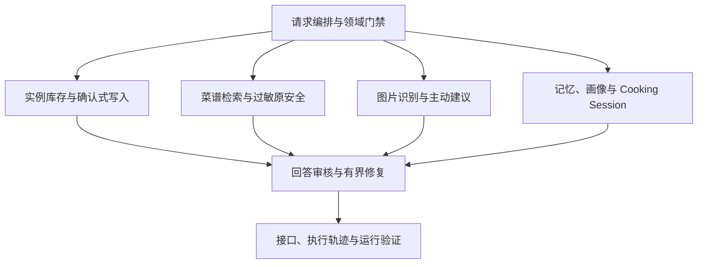

# Kitchen Inventory Agent 技术说明

本文按模块说明 Kitchen Inventory Agent 的职责、内部架构、关键工程决策和验证结果。它是 [README](../README.md) 的技术展开版；运行数据统一引用 [最终快速评测报告](快速评测报告.md)。

## 1. 请求编排与领域门禁

### 介绍

请求编排模块负责决定一条输入应由确定性代码直接处理、进入图片识别、交给 FastText 分类器，还是携带上下文进入 LangChain Agent。它的目的是让路径明确的操作尽早离开生成式链路，将模型调用留给真正需要语义理解的部分。

主要实现位于：

- `app/pipeline.py`：顶层请求生命周期与各服务编排；
- `app/intent.py`：确定性路由、简单库存意图和上下文依赖识别；
- `classifier/`：FastText 数据处理、训练、评估与运行时预测；
- `app/agent.py`：复杂请求的工具调用 Agent。

### 架构

`KitchenPipeline` 统一持有仓库、Agent、分类器、审核器、修复监督器、记忆与任务服务。一次请求只有一个顶层编排入口；确定性分支和 Agent 分支最终都会回到相同的审核、历史写入和执行轨迹流程。

### 工程细节

**确定性优先。** 单独问候、库存列表、精确名称查询、格式明确的新增，以及锚定完整实例 ID 的替换、删除和校准可以直接路由。这样既降低不必要的模型消耗，也避免明确操作在生成式链路中被改写。

**上下文优先于二分类。** “删掉它”“用了一半”“下一步呢”等表达不能仅凭当前文本分类。路由器先识别其上下文依赖，再注入最近相关历史或活动 Cooking Session。

**分类器 fail-open。** FastText 模型缺失、版本不兼容或预测失败时，请求继续进入后续意图处理，同时记录 `unavailable` 或 `fail-open` 轨迹。这里的取舍是：分类器用于节省成本和阻断明显领域外请求，不作为食品功能的单点可用性依赖。

**输入边界集中管理。** Agent 输入字符数、输出 token、HTTP 超时、递归深度和重试次数都由配置限制。图片请求不经过纯文本分类，以免 OCR 或视觉候选被错误当作普通领域外文本。

### 指标

| 指标 | 结果 | 说明 |
| --- | ---: | --- |
| 快速评测分类器准确率 | 95.59% | 快速系统评测口径 |
| 快速评测食物召回率 | 96.67% | 食品相关请求的召回能力 |
| 路由挑战集领域外拦截率 | 94.12% | 16/17 个领域外挑战样本被拦截 |
| 路由挑战集食物误拦率 | 26.09% | 6/23 个食物请求被误拦，作为后续增强方向保留 |
| 确定性白名单命中率 | 30.00% | 40 条挑战样本中 12 条无需分类器 |
| 路由延迟 P50 / P95 | 0.028 / 0.082 ms | 离线确定性与分类链路测量 |
| 在线拦截 token 节省 | 平均估算 145.33 tokens/次 | 3 条 DeepSeek 配对探针，属于小样本 `paired_estimate` |

分类器自身另有 272 条独立测试集评估：准确率 95.59%、精确率 90.62%、召回率 96.67%、假阳性率 4.95%。它与快速系统评测使用不同口径，分别描述模型离线效果与当前系统评测结果。

这些指标证明了确定性路由可以分担一部分请求，分类器能够拦截大多数领域外挑战样本，并保留较高的食品请求召回率。挑战集误拦率同时给出了当前路由边界的量化基线，可用于指导后续样本扩充和阈值优化。

## 2. 实例库存与确认式写入

### 介绍

库存模块把每次购入保存为独立实例，并以食材名称作为查询维度。它的目的是保留批次身份、原始数量表达和日期来源，使同名库存的查询与变更具有明确目标。

主要实现位于：

- `app/tools/inventory.py`：SQLite schema、实例查询与实际写入；
- `app/actions.py`：提案模型、持久化状态与允许列表执行；
- `app/expiry.py`：保质期结构化推断与安全回退；
- `app/audit.py`：库存工具结果和提案预览审核。

### 架构

### 工程细节

**实例身份是写权限边界。** 单实例修改必须使用完整 `instance_id`。同名查询返回多个结果时，Agent 必须要求用户明确目标；短 ID 前缀不能解除歧义。

**数量文本保持不透明。** `quantity_text` 只接受非空、单行且长度受限的字符串。数据库不做单位换算、合并或部分扣减；“用了一半”只有在系统能确定唯一实例并形成新的完整数量文本时，才会生成整项替换提案。

**五类写入共用确认门。** 当前允许操作为 `inventory.add`、`inventory.replace`、`inventory.remove`、`inventory.remove_all` 和 `inventory.confirm`。模型没有直接执行这些操作的接口。

**预览来自真实状态。** 新增预览展示拟新增值；替换并列当前值与新值；删除和校准展示完整目标快照；批量删除保存精确名称、全部目标和预计数量。确认时再次校验预览，避免持久化记录被篡改后执行。

**幂等与并发。** 确认通过 `BEGIN IMMEDIATE` 原子领取执行权。已经执行的提案再次确认只返回原结构化结果。提案状态与库存实际写入目前是两个 SQLite 事务，跨事务崩溃恢复是后续可增强方向。

**保质期安全回退。** 用户提供的带时区未来时间优先；否则模型只返回结构化候选。过去时间、无时区值、空结果或模型不可用都保存为 `expires_at=null`、`expiry_source=unknown`，不会阻止库存提案创建。

### 指标

| 指标 | 当前值 |
| --- | ---: |
| 允许的库存写操作 | 5 类 |
| 默认提案有效期 | 15 分钟 |
| 库存实例核心字段 | 7 个 |
| 评估中的库存场景 | 10 个 |
| 库存场景延迟 P50 / P95 | 28.94 / 34.95 ms |
| 端到端路径成功率 | 12/12 |

全量自动化测试还覆盖同名实例独立、原文保持、完整 ID 授权、预览复验、重复确认幂等、无匹配目标拒绝、日期回退、用户归属和结构化响应审核。最终全量结果为 497/497 通过。

这些指标和测试覆盖证明了实例级库存、提案确认、重复确认幂等与结构化审核可以在既定场景中协同运行。库存场景延迟也表明本地 SQLite 状态链路具有稳定的毫秒级响应表现。

## 3. 菜谱检索与过敏原安全

### 介绍

菜谱模块采用本地优先、外部补齐的检索策略。它的目的是在保证过敏原和排除食材约束的前提下，结合关键词匹配与向量语义召回，提高本地菜谱的可发现性，并在结果不足时返回真实的外部候选。

主要实现位于：

- `recommender/`：数据构建、SQLite/FTS5、FAISS、embedding 和 RRF；
- `app/tools/recipe.py`：本地与外部菜谱路由、去重和排序；
- `app/adapters/recipe_api.py`：Spoonacular、TheMealDB 和 DeepSeek Web Search 适配；
- `app/allergens.py`：官方与自定义过敏原约束。

### 架构

### 工程细节

**双路召回。** FTS5 擅长直接词项匹配，FAISS 使用固定 revision 的 `BAAI/bge-small-en-v1.5` 捕捉语义相近结果。RRF 不依赖两路原始分数处于相同尺度，因此适合融合异构召回器。

**构建产物校验。** 本地 Pipeline 启动时校验 SQLite 哈希和记录数、FAISS 文件、模型身份、关键模型文件 SHA-256、查询维度与 encoder 配置。任一不一致都会放弃本地 Pipeline 并转向外部来源，避免使用部分初始化的索引。

**硬过滤优先于排序。** Spoonacular 官方 intolerance 由代码确定性展开；自定义过敏原、已有食材和排除食材必须提供完整 `ingredient_mapping`。结果过滤逐字段匹配标题、步骤和每条原料，不把字段拼接成可能产生跨字段误匹配的长文本。

**外部服务有序降级。** 本地结果不足 3 条时，系统保留已有安全结果，再按 Spoonacular、TheMealDB、DeepSeek Web Search 顺序补齐。跨来源按 URL、`(source, id)` 和规范化标题去重；最终不足 3 条时返回实际结果并标记 degraded。

**排序取舍。** `default` 使用 RRF 顺序，`max-used-ingredients` 优先命中库存食材数，`min-missing-ingredients` 优先缺失食材数。当前饮食类型和制作时间主要参与语义相关性，不作为结构化硬保证。

### 指标

| 指标 | FTS5 | FAISS | RRF |
| --- | ---: | ---: | ---: |
| Recall@3 | 80.00% | 70.00% | 80.00% |
| Recall@10 | 93.33% | 90.00% | 93.33% |
| MRR@10 | 0.765 | 0.634 | 0.741 |
| 独占 Recall@10 命中 | 2 | 1 | — |

RRF 的 Recall@10 与最佳单路持平；两条召回路径仍分别贡献了对方无法命中的目标，说明它们具有互补性。30 个检索目标中，受阻食材违规为 0。这组目标由本地已收录菜谱构造，指标适用于当前语料内检索。

这些指标证明了 FTS5 和 FAISS 在当前语料中提供了互补召回，RRF 能保持最佳单路的 Recall@10，并将两路候选纳入统一排序。受阻食材违规为 0，证明评估覆盖的过敏原与排除食材约束均在检索结果中生效。

## 4. 对话记忆、长期画像与 Cooking Session

### 介绍

该模块把三种不同生命周期的状态分开：完整对话历史负责可追溯性，短期上下文服务当前交互，长期画像保存稳定事实，Cooking Session 保存一次烹饪活动的结构化工作状态。它的目的是让长期事实、当前对话和烹饪进度各自拥有清晰的更新规则与证据来源。

主要实现位于：

- `app/memory.py`：追加式对话历史、短期窗口和时间召回；
- `app/profile.py`、`app/profile_actions.py`、`app/profile_summary.py`：长期画像与证据更新；
- `app/tasks.py`：Cooking Session 的状态与菜谱证据；
- `app/templates/user_profile.md`：画像可读模板。

### 架构

### 工程细节

**历史与上下文分离。** 完整请求、最终回答、工具记录、确认结果、审核原因和轨迹永久追加保存；Agent 自动上下文只读取游标之后最近 10 段相关输入与输出。清空上下文推进游标，不删除历史。

**时间召回受用户边界约束。** `search_conversation_history_by_time` 使用带时区的半开区间，默认返回最新 20 段、最多 100 段。`user_id` 来自运行上下文，模型不能查询其他用户。

**画像以证据驱动。** 用户明确表达长期偏好时只创建 30 天有效的画像提案。自动总结至少需要两条真实证据；普通推断事实可静默替换旧的 `inferred` 事实，但必须要求或与 `user_confirmed` 冲突的候选仍需用户确认。

**画像写入可审计。** Markdown 前半部分供人阅读，隐藏的版本化 JSON 保存 revision、事实来源、证据、提案和审核事件。写入前检查 revision、证据格式、状态迁移和安全类别，再使用同目录临时文件原子替换。

**任务状态独立于聊天窗口。** 每位用户最多一个 `active` task，其他状态为 `paused` 或 `completed`。任务保存已确认的菜谱快照、原始查询、份数、版本和核对状态；普通话题变化不会自动切换任务。

**烹饪完成仍不直接扣库存。** 标记“已烹饪”后，全部用完生成删除提案，仍有剩余生成整项替换提案；数量不明确时集中询问，所有提案仍需独立确认。

### 指标

| 指标 | 当前值 |
| --- | ---: |
| 自动短期上下文 | 最近 10 段相关交互 |
| 显式时间召回 | 默认 20、最多 100 段 |
| 自动画像总结触发 | 每 10 段新相关历史 |
| 自动推断所需证据 | 至少 2 条 |
| 每条事实保留证据 | 最多 5 条 |
| 每类生效事实 | 最多 20 条 |
| 画像提案有效期 | 30 天 |
| 画像审核事件 | 最近 200 条 |
| Cooking Session 评估场景 | 6 个 |
| 仅依赖历史的事实保留率 | 20% |
| 使用结构化 task 的事实保留率 | 100% |

Cooking Session 的结构化状态将 6 个评估场景中的事实错误率从 80% 降至 0。该结果的适用范围是评估中覆盖的烹饪状态场景。

这些指标证明了结构化 Cooking Session 能够完整保留评估场景中的菜谱与任务事实，相比仅依赖对话历史显著降低状态丢失。上下文、画像和证据数量限制也明确了记忆模块的运行边界。

## 5. 图片识别与主动库存建议

### 介绍

图片识别用于把食材候选加入当前请求上下文；主动建议用于在用户再次访问时提示高优先级库存状态。该模块的目的是在使用模型和外部视觉服务的同时，通过确定性校验、持久化确认点和固定模板控制输入质量与可执行范围。

主要实现位于：

- `app/vision.py`、`app/adapters/vision_api.py`：图片校验、百度识别和置信度分层；
- `app/vision_confirmations.py`：低置信度人工确认；
- `app/proactive.py`：访问节流、候选选择和固定提醒模板。

### 架构

### 工程细节

**先验证文件再调用外部服务。** 图片限制为 JPEG、PNG 或 BMP，最大 3 MiB，边长 15–4096 px，长宽比不超过 3:1，并要求 Pillow 能实际解码内容。

**置信度决定交互层级。** 高置信度候选只进入请求上下文，中置信度候选附加确定性核对提示，低置信度候选暂停原请求并建立持久化确认点。图片识别本身不会创建库存写入。

**确认结果可恢复。** 用户可以选择候选、修改名称或放弃；确认项必须存在于持久化记录中，之后系统恢复原请求。最终选择会保存，便于重复读取和审计。

**主动检查采用访问节流。** 首次访问只建立基线；距上次访问正好 24 小时不触发，严格超过 24 小时才扫描。读旧时间与写新时间在 `BEGIN IMMEDIATE` 内完成，因此并发访问最多一个请求取得检查资格。

**模型只能选择，不能撰写提醒。** 候选优先级为已过期、3 天内临期、超过 14 天未确认、可能缺货。模型只能返回类别和真实库存中的食材名，最终内容由固定模板渲染；异常时使用确定性候选或返回 `null`。

### 指标

该模块在最终快速 benchmark 中没有单独的准确率或召回率汇总，因此不将其他模块指标移作视觉效果结论。当前可验证的工程约束如下：

| 约束指标 | 当前值 |
| --- | ---: |
| 最大图片大小 | 3 MiB |
| 图片边长 | 15–4096 px |
| 最大长宽比 | 3:1 |
| 高置信度阈值 | 0.85 |
| 人工确认阈值 | 低于 0.50 |
| 主动检查间隔 | 严格超过 24 小时 |
| 临期窗口 | 未来 3 天 |
| 未确认窗口 | 严格超过 14 天 |
| 提醒最大长度 | 100 个 Unicode 字符 |

自动化测试覆盖文件校验、三档置信度、候选选择与恢复、24 小时边界、并发抑制、优先级、模型异常回退、单句长度和只读副作用。

这些工程约束和测试覆盖证明了图片输入会在外部调用前接受确定性校验，低置信度结果会进入人工确认，主动建议会遵守访问节流、长度限制和只读边界。当前证据用于验证交互与安全约束。

## 6. 回答审核与有界修复

### 介绍

审核模块位于工具执行与最终响应之间，负责确认模型回答是否与真实工具记录一致、是否遗漏必要工具调用、是否包含危险执行声明，以及图片确认和菜谱来源是否满足约束。该模块的目的是阻止缺少依据或违反执行边界的回答进入用户结果，并通过最小权限修复提高安全回答的可用率。

主要实现位于：

- `app/audit.py`：正则审核、工具记录审核与规范化回答；
- `app/supervisor.py`：修复决策、子 Agent 重写和主 Agent 重试；
- `app/structured_output.py`：结构化模型输出适配。

### 架构

### 工程细节

**库存回答规范化。** 当工具历史包含库存读取或提案时，系统丢弃模型撰写的库存段落，按真实结构化结果生成固定 Markdown。完整实例 ID、原始数量、日期来源、提案状态和 action ID 都由代码输出。

**工具与回答双向一致。** 审核器校验工具名称、参数、结果字段、UTC 时间、实例身份、提案 operation 和 preview。菜谱回答还要求标题、原料、步骤和 HTTP(S) 来源均能在 `search_recipes` 结果中找到。

**修复权限最小化。** 表达问题由无工具子 Agent 改写；菜谱缺少工具或结果不一致时，主 Agent 仅可在恢复模式调用一次 `search_recipes`。修复不能创建新的库存提案，也不能修改原有工具记录。

**生成次数有硬上限。** 初始回答后最多一次子 Agent 修复和一次主 Agent 重试，不进行第三次生成。中间草稿不写入用户历史，最终失败返回固定安全文案。

**故障注入与合法样本分开统计。** 风险检出率用于验证已知违规模式能否被拦截，合法样本用于观察误拦；两者都不被解释为生产事故发生率。

### 指标

| 指标 | 结果 |
| --- | ---: |
| 风险回答检出 | 30/30 |
| 风险回答接受率 | 0% |
| 合法回答放行 | 15/15 |
| 合法回答误拦率 | 0% |
| 已覆盖风险类别召回率 | 100% |
| 修复子 Agent 有效决策 | 6/6 |
| 成功直接重写 | 2 次 |
| 正确要求主 Agent 重试 | 2 次 |
| 实际 DeepSeek 调用 | 6 次 |
| 累计输入 / 输出 token | 3,083 / 252 |
| 累计实际 token | 3,335 |

6 个样本的最终结果均为有效决策。

这些指标证明了审核器能够覆盖评测中的全部已知风险类型，同时放行全部合法样本；修复子 Agent 也能在所有样本中选择有效动作。累计 token 为这条安全恢复链路提供了实际成本基线。

## 7. 接口、执行轨迹与运行验证

### 介绍

交付层同时提供 FastAPI Web 接口、展示页和 CLI。每次请求都返回可视化执行轨迹，并把最终回答与实际执行阶段写入追加式历史。该模块的目的是提供统一的调用入口和可追溯证据，使用户结果能够回溯到路由、工具、外部服务和审核决策。

主要实现位于：

- `app/web.py`：HTTP API、输入模型和用户边界；
- `app/trace.py`：请求级阶段记录；
- `frontend/`：库存卡片、提案预览、Cooking Session 与轨迹展示；
- `main.py`：CLI 入口；
- `evaluation/`：分层 benchmark、预算控制和报告生成。

### 架构

### 工程细节

**轨迹只记录安全摘要。** 每个事件包含阶段、名称、状态、说明和耗时；异常只保存类型与安全摘要，不把密钥或原始供应商响应返回前端。

**确认接口绕过生成式链路。** `/api/actions/{action_id}/confirm` 与 `/cancel` 直接执行状态转换并返回序列化 action，不再次调用模型。任务、图片确认和画像提案也通过各自的结构化 HTTP 接口完成。

**安全边界覆盖前后端。** 页面会在 preview 不完整时隐藏并禁用确认按钮，服务端同时执行独立复验。Markdown 渲染先进行 HTML 转义，只把 HTTP(S) 来源转换为带 `noopener noreferrer` 的链接。

**评估分层。** 离线 quick suite 不发送网络请求；在线模式只运行有明确数量与预算上限的 DeepSeek 探针和修复样本。报告区分 `measured`、`fault_injection`、`paired_estimate`、`unavailable` 和 `skipped`，避免将估算、注入测试和实测混为一类。

**当前展示范围。** Web 页面使用固定 showcase 用户；底层库存、提案、历史、任务、访问记录和图片确认按 `user_id` 保存或检查。账户注册、登录和多租户认证属于产品化演进方向。

### 指标

| 指标 | 结果 |
| --- | ---: |
| 全量自动化测试 | 497/497 通过 |
| 全量测试耗时 | 39.79 秒 |
| 完整离线评估 | 无 `skipped` / `unavailable` |
| 端到端评估路径 | 12 个 |
| 端到端路径成功率 | 100% |
| 端到端评估网络调用 | 0 |
| 端到端延迟 P50 / P95 | 0.003 / 0.008 ms |

端到端评估使用隔离的临时 SQLite 数据库，主要验证混合请求路径、状态转换与阻断结果。延迟数据适用于无网络调用的离线评估环境。

这些指标证明了评估覆盖的端到端路径均能在隔离数据库中完成预期状态转换与阻断，并且完整离线评估可以在依赖可用的情况下无跳过运行。497 项自动化测试为各模块之间的接口契约提供了整体回归证据。

评估复现方法、离线与在线模式说明见 [evaluation/README.md](../evaluation/README.md)。

## 模块关系总结

整个系统的核心取舍是：模型负责理解和候选生成，确定性代码负责身份、状态、权限、事实与最终执行。这个边界让自然语言交互保持灵活，同时使库存变更、过敏原过滤和回答事实具备可确认、可复现、可追溯的工程属性。
